<h1 align="center"></h1>

How fast are the TypeScript type checkers, and how do their diagnostics compare with tsgo's? This benchmark runs a full-program type check of real projects, in a fresh process with no incremental cache, with every checker, on the same machine, in the same session. It compares their speed, memory and diagnostics with Microsoft's tsgo, and publishes the raw output behind every number.

New checker or new version? Edit one line in [`checkers.json`](checkers.json) and run the benchmark ([below](#add-a-checker-or-a-version)).

## Results

<!-- results:start -->
<!-- Generated by `node bench report` from results/2026-10-18-apple-m5-darwin/. Do not edit by hand. -->

Latest run: [`2026-10-18-apple-m5-darwin`](results/2026-10-18-apple-m5-darwin/report.md), Apple M5, macOS 26.5.1 (25F80), 2026-10-18. Wall time is the median of 7 runs (min–max); "vs tsgo" is tsgo's median divided by the checker's. ¹: the checker reported errors where tsgo reported none.

Default threading differs: tsgo and tsc-rs default to 4 checkers; tsc-ts, tsrs and bun use one per core, up to 10 on this 10-core machine ([sources](docs/METHOD.md#threads)).

tsc-rs and tsrs port TypeScript 7.1.0-dev and report errors that tsgo 7.0.2 does not on the clean Outline (1) and VS Code (10), so on those projects they are not drop-in replacements for tsgo 7.0.2.







The same races single-threaded, every checker with its documented one-thread flag: [in the run's report](results/2026-10-18-apple-m5-darwin/report.md#single-threaded).

### Default threading

| Checker | type-fest wall s | vs tsgo | outline wall s | vs tsgo | vscode wall s | vs tsgo |
|---|---|---|---|---|---|---|
| tsgo | 7.44 (7.24–7.56) | 1.0× | 4.42 (4.36–4.45) | 1.0× | 8.21 (7.99–8.87) | 1.0× |
| tsc-ts | 1.67 (1.65–1.77) | 4.5× | 1.17 (1.17–1.21) | 3.8× | 3.79 (3.77–3.81) | 2.2× |
| tsc-rs | 2.19 (2.17–2.21) | 3.4× | 1.84 (1.82–1.87) ¹ | 2.4× | 3.36 (3.34–3.39) ¹ | 2.4× |
| tsrs | 1.70 (1.68–1.73) | 4.4× | 0.81 (0.80–0.85) ¹ | 5.5× | 1.44 (1.43–1.46) ¹ | 5.7× |
| bun | 1.37 (1.36–1.37) | 5.4× | 1.19 (1.17–1.21) | 3.7× | 2.53 (2.51–2.57) | 3.2× |

| Checker | type-fest user+sys s / peak MiB | outline user+sys s / peak MiB | vscode user+sys s / peak MiB |
|---|---|---|---|
| tsgo | 27.72 / 8360 | 18.61 / 3252 | 41.62 / 9046 |
| tsc-ts | 10.90 / 6134 | 10.18 / 2376 | 33.04 / 7115 |
| tsc-rs | 4.48 / 4123 | 5.42 / 1807 | 13.77 / 6248 |
| tsrs | 7.10 / 1819 | 6.31 / 1053 | 12.41 / 2331 |
| bun | 5.60 / 1415 | 8.90 / 1025 | 21.53 / 2288 |

### Single-threaded

tsgo, tsc-ts, tsc-rs, tsrs, bun, each with its documented single-thread flag.

| Checker | type-fest wall s | vs tsgo | outline wall s | vs tsgo | vscode wall s | vs tsgo |
|---|---|---|---|---|---|---|
| tsgo | 13.44 (13.36–13.80) | 1.0× | 7.99 (7.98–8.08) | 1.0× | 21.65 (21.32–21.78) | 1.0× |
| tsc-ts | 5.18 (5.17–5.21) | 2.6× | 3.50 (3.49–3.52) | 2.3× | 16.88 (16.60–17.98) | 1.3× |
| tsc-rs | 3.73 (3.71–3.74) | 3.6× | 3.23 (3.18–3.25) ¹ | 2.5× | 10.09 (9.94–10.19) ¹ | 2.1× |
| tsrs | 4.40 (4.39–4.42) | 3.1× | 2.16 (2.14–2.22) ¹ | 3.7× | 6.65 (6.55–6.73) ¹ | 3.3× |
| bun | 4.04 (4.01–4.04) | 3.3× | 3.31 (3.29–3.37) | 2.4× | 12.31 (12.17–12.44) | 1.8× |

### 10 threads

tsgo, tsc-ts, tsc-rs, tsrs, bun, each set to 10 with its documented thread flag, one per core on this machine.

| Checker | type-fest wall s | vs tsgo | outline wall s | vs tsgo | vscode wall s | vs tsgo |
|---|---|---|---|---|---|---|
| tsgo | 5.51 (5.18–5.68) | 1.0× | 4.26 (4.16–4.47) | 1.0× | 7.71 (7.12–8.06) | 1.0× |
| tsc-ts | 1.68 (1.64–1.70) | 3.3× | 1.25 (1.22–1.33) | 3.4× | 3.75 (3.73–3.77) | 2.1× |
| tsc-rs | 1.58 (1.56–1.61) | 3.5× | 1.58 (1.50–1.69) ¹ | 2.7× | 2.87 (2.85–3.67) ¹ | 2.7× |
| tsrs | 1.68 (1.67–1.71) | 3.3× | 0.87 (0.83–0.94) ¹ | 4.9× | 1.43 (1.42–1.67) ¹ | 5.4× |
| bun | 1.37 (1.33–1.39) | 4.0× | 1.26 (1.23–1.30) | 3.4× | 2.50 (2.49–2.84) | 3.1× |

### Diagnostics compared with tsgo

| Project, state | tsgo errors | tsc-ts | tsc-rs | tsrs | bun | tsgo-7.1-dev | tsgo-7.1-dev-20261008 |
|---|---|---|---|---|---|---|---|
| type-fest, clean | 0 | byte-identical | byte-identical | byte-identical | same after normalising | byte-identical | byte-identical |
| type-fest, broken | 6 | byte-identical | +1 / −1 | +1 / −1 | same after normalising | +1 / −1 | +1 / −1 |
| outline, clean | 0 | byte-identical | +1 / −0 | +1 / −0 | same after normalising | +1 / −0 | +1 / −0 |
| outline, broken | 3 | byte-identical | +1 / −0 | +1 / −0 | same after normalising | +1 / −0 | +1 / −0 |
| vscode, clean | 0 | byte-identical | +10 / −0 | +10 / −0 | same after normalising | +10 / −0 | +10 / −0 |
| vscode, broken | 3 | byte-identical | +10 / −0 | +10 / −0 | same after normalising | +10 / −0 | +10 / −0 |

+n / −m: after normalising, n diagnostics only in that checker and m only in the reference. Every difference is listed verbatim in the run's report.

### Diagnostics compared with each checker's upstream build

Checkers that port a different TypeScript build, compared byte for byte with that build's own output.

| Checker | Its upstream build | type-fest, clean | type-fest, broken | outline, clean | outline, broken | vscode, clean | vscode, broken |
|---|---|---|---|---|---|---|---|
| tsc-rs | tsgo-7.1-dev-20261008 (`typescript@7.1.0-dev.20261008.1`) | byte-identical | byte-identical | byte-identical | byte-identical | byte-identical | byte-identical |
| tsrs | tsgo-7.1-dev (`typescript@7.1.0-dev.20260930.4`) | byte-identical | byte-identical | byte-identical | byte-identical | byte-identical | byte-identical |

Full report, with every thread setting, the cold check, file lists and every diagnostic difference verbatim: [`results/2026-10-18-apple-m5-darwin/report.md`](results/2026-10-18-apple-m5-darwin/report.md).
<!-- results:end -->

How to read these: every checker runs with its shipped defaults, plus only the project's own typecheck arguments. No tuning flags are used: not tsrs's `--checkerAssignment go`, and not tsc-rs's `--fast`. The first table uses each checker's default threading, and those defaults differ; the single-threaded table sets one thread with each checker's documented flag ([details](docs/METHOD.md#threads)). tsc-rs and tsrs port TypeScript 7.1-dev, not 7.0.2; the "explain" checker, upstream tsgo 7.1-dev, shows which of their diagnostic differences come from TypeScript 7.1 itself. Method, caveats and what the numbers do not show: [`docs/METHOD.md`](docs/METHOD.md).

## Checkers and projects

| Checker | Package |
|---|---|
| tsgo (reference) | [`typescript@7.0.2`](https://www.npmjs.com/package/typescript) |
| tsc-ts | [`tsc-ts@0.0.3`](https://www.npmjs.com/package/tsc-ts) |
| tsc-rs | [`tsc-rs@0.7.0`](https://www.npmjs.com/package/tsc-rs) |
| tsrs | [`tsrs@0.16.0-ts7.1.0-dev.20260929`](https://www.npmjs.com/package/tsrs) |
| bun check | [`bun@1.4.3`](https://www.npmjs.com/package/bun) |
| tsgo 7.1-dev (diagnostics only, not timed) | [`typescript@7.1.0-dev.20260930.4`](https://www.npmjs.com/package/typescript) |

| Project | Why |
|---|---|
| [type-fest](https://github.com/sindresorhus/type-fest) | Type-level library; heavy conditional types in its own test suite |
| [outline](https://github.com/outline/outline) | A product web app, about 2,300 TypeScript files outside `node_modules` |
| [VS Code](https://github.com/microsoft/vscode) | A large product, about 10,600 TypeScript files in `src/` |

Each project is pinned to a commit, installed with its own lockfile and checked with its own typecheck command ([`projects.json`](projects.json)). A project is benchmarked only if tsgo reports 0 errors on it; [excalidraw](https://github.com/excalidraw/excalidraw) is in the list and rejected by that rule, because TypeScript 7 removed its `baseUrl` option.

## Run it

Runs on macOS, Linux (glibc) and Windows, on x64 and arm64. Requires Node ≥ 22.18 and git. On Linux it also needs GNU time; installing VS Code has its own build prerequisites. [`AGENTS.md`](AGENTS.md) has the full list and the exact steps, written so that a person or an agent can follow them on a new machine.

```sh
(cd bench && npm ci && npm run check)   # the harness's own typecheck and tests
node bench setup        # every checker into tools/, every project into projects/ (about 10 GB)
node bench preflight    # plugged in? anything busy?
node bench run --smoke  # about 8 minutes: end-to-end check into results/.smoke/ (not published)
node bench run          # about an hour; writes results/<date>-<cpu>-<os>/
```

`node bench run` keeps the machine awake (caffeinate, systemd-inhibit or SetThreadExecutionState), stops if it leaves AC power, and writes the run's report and this README's results block at the end. `node bench run --dry-run` prints every command it would run.

## Add a checker or a version

1. Add or edit an entry in [`checkers.json`](checkers.json): npm package and version, the native binary its bin runs, and its thread flag if its own `--help` or README documents one.
2. `node bench setup`, which pins it in `tools/<name>/` with a lockfile.
3. `node bench run`, then open a pull request with `checkers.json`, `tools/<name>/` and the new `results/` folder.

Projects are added the same way, in [`projects.json`](projects.json), with the project's own install and typecheck commands and a patch of deliberate type errors in `fixtures/patches/`.

## Layout

| Path | |
|---|---|
| [`checkers.json`](checkers.json), [`projects.json`](projects.json) | What is benchmarked |
| [`bench/`](bench/) | The harness (`node bench <command>`) and the report generator |
| [`tools/`](tools/) | One pinned install per checker |
| [`fixtures/`](fixtures/) | Error-injection patches and type-fest's lockfile |
| [`results/`](results/) | One folder per run: `run.json` (machine, versions, binary hashes, conditions), `timing.csv`, diagnostics, file lists, work counts, `--help` output, `report.md` and a `race-<project>.svg` per project |
| [`docs/METHOD.md`](docs/METHOD.md) | Method and caveats |

## Independence

This benchmark is independent. Its author is not affiliated with Microsoft, Vercel, Oven (bun) or the authors of tsc-ts, tsc-rs or tsrs, and no one funded or reviewed it before publication.

## Corrections

If a checker is misconfigured, a flag is missing, or a number looks wrong, open an issue with the run, file and line. Fixes land as new commits; published runs are not rewritten.

## License

[MIT](LICENSE)
