# Run 2026-10-18-apple-m5-darwin

Apple M5, 10 CPUs, 24 GiB, macOS 26.5.1 (25F80), darwin-arm64, Node v24.13.0. 2026-10-18T22:39:24.865Z to 2026-10-18T23:21:36.335Z.

Generated by `bench/report.ts` from the files in this directory. Wall time: median of 7 runs (min–max), after 1 warm-up round, checkers alternating. "vs tsgo": tsgo's median divided by the checker's. ¹: the checker exited non-zero (it reported errors).

## Conditions

- Power: all 570 runs on AC. Charge 100–100%.
- Kept awake by: caffeinate.
- Sleep, wake and thermal events during the run (pmset -g log): none.
- 1-minute load average 2.66 at the start, 11.19 at the end (the checkers' own threads raise it).
- Preflight warnings: 1 busy process using 15% CPU or more (highest 26.5%).
- Cold check: files written to the fresh HOME, TMPDIR, XDG_CACHE_HOME: none.

## Checkers

| Checker | Package | Reports itself as | Native binary sha256 |
|---|---|---|---|
| tsgo | `typescript@7.0.2` | `Version 7.0.2` | `a82f731365ad69d5c4c15f5e18fba4584bf3b7b839960172a76c3462b5114bf2` |
| tsc-ts | `tsc-ts@0.0.3` | `Version 7.0.2` | `b2a89e76dafa63ffece5e410d6c330ed58974ed14082788735dd9a2abfc43865` |
| tsc-rs | `tsc-rs@0.7.0` | `Version 7.1.0-dev` | `23dd7b5cf77478cd6bc0f9ea40ce5807ecb69a4a4f4b16f4d1323becafb54cc7` |
| tsrs | `tsrs@0.16.0-ts7.1.0-dev.20260929` | `Version 7.1.0-dev.20260930.4 (tsrs 0.16.0-ts7.1.0-dev.20260929, microsoft/TypeScript@b85298b6a81f)` | `c04e14af7538fd95272c40e4902d6048aa637cecd40cb3429b94f646e20ebceb` |
| bun | `bun@1.4.3` | `1.4.3` | `28c7dd0a06916aba284d570ef44a2d70e9c538eaf2ba58dfe0910525563b3f79` |
| tsgo-7.1-dev (diagnostics only) | `typescript@7.1.0-dev.20260930.4` | `Version 7.1.0-dev.20260930.4` | `aa06f5318220fe61dce847ef5583f01ee17a250ca5565dbf46c259588fe97246` |
| tsgo-7.1-dev-20261008 (diagnostics only) (added 2026-10-19, after the run) | `typescript@7.1.0-dev.20261008.1` | `Version 7.1.0-dev.20261008.1` | `3c61fc74c866133d6e39327bd056d78f5bfafa693decfba774a925a718fab246` |

## Projects

| Project | Commit | Command | Gate |
|---|---|---|---|
| [type-fest](https://github.com/sindresorhus/type-fest) | `b550b410e13f` | `-p . --noEmit` (package.json test:tsc (tsc on the repo tsconfig, which sets noEmit)) | 0 errors |
| [outline](https://github.com/outline/outline) | `ef7753dc57a6` | `-p . --incremental false` (.github/workflows/ci.yml, job types: yarn tsc --incremental false) | 0 errors |
| [vscode](https://github.com/microsoft/vscode) | `4a82da11e45f` | `-p ./src/tsconfig.json --noEmit --skipLibCheck` (package.json typecheck-client) | 0 errors |
| [excalidraw](https://github.com/excalidraw/excalidraw) | `4c37956ba5f0` | `-p .` (package.json test:typecheck) | **rejected**: `tsconfig.json(20,5): error TS5102: Option 'baseUrl' has been removed. Please remove it from your configuration.` |

## Default threading

| Checker | type-fest wall s | vs tsgo | outline wall s | vs tsgo | vscode wall s | vs tsgo |
|---|---|---|---|---|---|---|
| tsgo | 7.44 (7.24–7.56) | 1.0× | 4.42 (4.36–4.45) | 1.0× | 8.21 (7.99–8.87) | 1.0× |
| tsc-ts | 1.67 (1.65–1.77) | 4.5× | 1.17 (1.17–1.21) | 3.8× | 3.79 (3.77–3.81) | 2.2× |
| tsc-rs | 2.19 (2.17–2.21) | 3.4× | 1.84 (1.82–1.87) ¹ | 2.4× | 3.36 (3.34–3.39) ¹ | 2.4× |
| tsrs | 1.70 (1.68–1.73) | 4.4× | 0.81 (0.80–0.85) ¹ | 5.5× | 1.44 (1.43–1.46) ¹ | 5.7× |
| bun | 1.37 (1.36–1.37) | 5.4× | 1.19 (1.17–1.21) | 3.7× | 2.53 (2.51–2.57) | 3.2× |

| Checker | type-fest user+sys s / peak MiB | outline user+sys s / peak MiB | vscode user+sys s / peak MiB |
|---|---|---|---|
| tsgo | 27.72 / 8360 | 18.61 / 3252 | 41.62 / 9046 |
| tsc-ts | 10.90 / 6134 | 10.18 / 2376 | 33.04 / 7115 |
| tsc-rs | 4.48 / 4123 | 5.42 / 1807 | 13.77 / 6248 |
| tsrs | 7.10 / 1819 | 6.31 / 1053 | 12.41 / 2331 |
| bun | 5.60 / 1415 | 8.90 / 1025 | 21.53 / 2288 |

## Single-threaded

tsgo, tsc-ts, tsc-rs, tsrs, bun; checkers without a documented thread flag are not included.

| Checker | type-fest wall s | vs tsgo | outline wall s | vs tsgo | vscode wall s | vs tsgo |
|---|---|---|---|---|---|---|
| tsgo | 13.44 (13.36–13.80) | 1.0× | 7.99 (7.98–8.08) | 1.0× | 21.65 (21.32–21.78) | 1.0× |
| tsc-ts | 5.18 (5.17–5.21) | 2.6× | 3.50 (3.49–3.52) | 2.3× | 16.88 (16.60–17.98) | 1.3× |
| tsc-rs | 3.73 (3.71–3.74) | 3.6× | 3.23 (3.18–3.25) ¹ | 2.5× | 10.09 (9.94–10.19) ¹ | 2.1× |
| tsrs | 4.40 (4.39–4.42) | 3.1× | 2.16 (2.14–2.22) ¹ | 3.7× | 6.65 (6.55–6.73) ¹ | 3.3× |
| bun | 4.04 (4.01–4.04) | 3.3× | 3.31 (3.29–3.37) | 2.4× | 12.31 (12.17–12.44) | 1.8× |

## 4 threads

tsgo, tsc-ts, tsc-rs, tsrs, bun; checkers without a documented thread flag are not included.

| Checker | type-fest wall s | vs tsgo | outline wall s | vs tsgo | vscode wall s | vs tsgo |
|---|---|---|---|---|---|---|
| tsgo | 7.46 (7.16–7.68) | 1.0× | 4.57 (4.37–4.59) | 1.0× | 8.31 (8.18–9.13) | 1.0× |
| tsc-ts | 2.10 (1.99–2.19) | 3.6× | 1.46 (1.39–1.48) | 3.1× | 5.21 (5.13–5.38) | 1.6× |
| tsc-rs | 2.21 (2.19–2.26) | 3.4× | 1.92 (1.85–1.98) ¹ | 2.4× | 3.37 (3.32–3.49) ¹ | 2.5× |
| tsrs | 1.69 (1.65–1.73) | 4.4× | 0.90 (0.87–0.92) ¹ | 5.1× | 1.99 (1.96–2.04) ¹ | 4.2× |
| bun | 1.65 (1.62–1.66) | 4.5× | 1.70 (1.65–1.71) | 2.7× | 3.74 (3.67–3.84) | 2.2× |

## 10 threads

tsgo, tsc-ts, tsc-rs, tsrs, bun; checkers without a documented thread flag are not included.

| Checker | type-fest wall s | vs tsgo | outline wall s | vs tsgo | vscode wall s | vs tsgo |
|---|---|---|---|---|---|---|
| tsgo | 5.51 (5.18–5.68) | 1.0× | 4.26 (4.16–4.47) | 1.0× | 7.71 (7.12–8.06) | 1.0× |
| tsc-ts | 1.68 (1.64–1.70) | 3.3× | 1.25 (1.22–1.33) | 3.4× | 3.75 (3.73–3.77) | 2.1× |
| tsc-rs | 1.58 (1.56–1.61) | 3.5× | 1.58 (1.50–1.69) ¹ | 2.7× | 2.87 (2.85–3.67) ¹ | 2.7× |
| tsrs | 1.68 (1.67–1.71) | 3.3× | 0.87 (0.83–0.94) ¹ | 4.9× | 1.43 (1.42–1.67) ¹ | 5.4× |
| bun | 1.37 (1.33–1.39) | 4.0× | 1.26 (1.23–1.30) | 3.4× | 2.50 (2.49–2.84) | 3.1× |

## Work per project

tsgo's own counts of the work in one check (`--extendedDiagnostics --singleThreaded`, not timed), from `work/`. Files and lines include `node_modules` and lib files. Parse and check times are from that one single-threaded run. A project's check time depends far more on how many types it makes the checker create than on its file count. Counts can vary very slightly between runs. Recorded on 2026-10-19, after this run, on the same machine with the same tsgo binary (sha256 a82f731365ad…) and project commits as the timed runs. These counts depend on the binary and the code, not on timing conditions, though they are not exactly repeatable: in repeated checks, type-fest's varied by under 0.01% and the other projects' not at all.

| Project | Files in program | Lines | Types | Instantiations | Parse s | Check s |
|---|---|---|---|---|---|---|
| type-fest | 593 | 0.1 M | 5.9 M | 17.8 M | 0.1 | 13.7 |
| Outline | 7,783 | 1.4 M | 0.6 M | 5.8 M | 1.6 | 7.3 |
| VS Code | 11,500 | 4.0 M | 3.3 M | 4.2 M | 3.5 | 20.0 |

## Cold check

Normal environment vs fresh empty HOME, TMPDIR, XDG_CACHE_HOME, 3 runs each.

| Checker | type-fest normal | type-fest fresh | outline normal | outline fresh | vscode normal | vscode fresh |
|---|---|---|---|---|---|---|
| tsgo | 7.45–7.71 | 7.35–7.51 | 4.44–4.46 | 4.43–4.49 | 8.10–8.77 | 7.92–8.10 |
| tsc-ts | 1.69–1.78 | 1.67–1.72 | 1.18–1.20 | 1.17–1.18 | 3.78–3.82 | 3.80–3.81 |
| tsc-rs | 2.19–2.26 | 2.18–2.22 | 1.84–1.93 | 1.85–1.88 | 3.34–3.38 | 3.31–3.33 |
| tsrs | 1.70–1.72 | 1.69–1.71 | 0.86–0.86 | 0.81–0.82 | 1.48–1.49 | 1.43–1.44 |
| bun | 1.38–1.41 | 1.37–1.39 | 1.23–1.25 | 1.21–1.23 | 2.58–2.62 | 2.53–2.55 |

## Files in each program

`--listFilesOnly` per checker (bun documents no way to list files; its `--timing` counts are shown; its "checked" count leaves out files it does not type-check, explained in [METHOD](../../docs/METHOD.md#files)). Project files: outside `node_modules` and the checker's bundled `lib.*.d.ts`.

### type-fest

| Checker | Files | Lib files | Project files | Same as tsgo |
|---|---|---|---|---|
| tsgo | 593 | 89 | 502 | same list |
| tsc-ts | 593 | 89 | 502 | same list |
| tsc-rs | 599 | 95 | 502 | same non-lib files; lib files differ (+10 / −4) |
| tsrs | 597 | 93 | 502 | same non-lib files; lib files differ (+8 / −4) |
| bun | 593 loaded, 593 checked | – | – | same count |

### outline

| Checker | Files | Lib files | Project files | Same as tsgo |
|---|---|---|---|---|
| tsgo | 7783 | 48 | 2315 | same list |
| tsc-ts | 7783 | 48 | 2315 | same list |
| tsc-rs | 7783 | 48 | 2315 | same list |
| tsrs | 7783 | 48 | 2315 | same list |
| bun | 7783 loaded, 2272 checked | – | – | same count |

### vscode

| Checker | Files | Lib files | Project files | Same as tsgo |
|---|---|---|---|---|
| tsgo | 11500 | 74 | 10645 | same list |
| tsc-ts | 11500 | 74 | 10645 | same list |
| tsc-rs | 11500 | 74 | 10645 | same list |
| tsrs | 11500 | 74 | 10645 | same list |
| bun | 11500 loaded, 10427 checked | – | – | same count |

## Diagnostics

Each checker ran twice on each project, clean and with `fixtures/patches/<project>.patch` applied. Compared with tsgo byte for byte, and after normalising to one `path:line:col code message` line per diagnostic (elaboration lines and bun's summary dropped).

| Project, state | tsgo errors | tsc-ts | tsc-rs | tsrs | bun | tsgo-7.1-dev | tsgo-7.1-dev-20261008 |
|---|---|---|---|---|---|---|---|
| type-fest, clean | 0 | byte-identical | byte-identical | byte-identical | same after normalising | byte-identical | byte-identical |
| type-fest, broken | 6 | byte-identical | +1 / −1 | +1 / −1 | same after normalising | +1 / −1 | +1 / −1 |
| outline, clean | 0 | byte-identical | +1 / −0 | +1 / −0 | same after normalising | +1 / −0 | +1 / −0 |
| outline, broken | 3 | byte-identical | +1 / −0 | +1 / −0 | same after normalising | +1 / −0 | +1 / −0 |
| vscode, clean | 0 | byte-identical | +10 / −0 | +10 / −0 | same after normalising | +10 / −0 | +10 / −0 |
| vscode, broken | 3 | byte-identical | +10 / −0 | +10 / −0 | same after normalising | +10 / −0 | +10 / −0 |

+n / −m: after normalising, n diagnostics only in that checker and m only in the reference. Every difference is listed verbatim in the run's report.

### Compared with each checker's upstream build

Checkers that port a different TypeScript build, compared byte for byte with that build's own output.

| Checker | Its upstream build | type-fest, clean | type-fest, broken | outline, clean | outline, broken | vscode, clean | vscode, broken |
|---|---|---|---|---|---|---|---|
| tsc-rs | tsgo-7.1-dev-20261008 (`typescript@7.1.0-dev.20261008.1`) | byte-identical | byte-identical | byte-identical | byte-identical | byte-identical | byte-identical |
| tsrs | tsgo-7.1-dev (`typescript@7.1.0-dev.20260930.4`) | byte-identical | byte-identical | byte-identical | byte-identical | byte-identical | byte-identical |

| Project | State | Checker | Errors | Repeat run identical | Exit codes |
|---|---|---|---|---|---|
| type-fest | clean | tsgo | 0 | yes | 0, 0 |
| type-fest | clean | tsc-ts | 0 | yes | 0, 0 |
| type-fest | clean | tsc-rs | 0 | yes | 0, 0 |
| type-fest | clean | tsrs | 0 | yes | 0, 0 |
| type-fest | clean | bun | 0 | yes | 0, 0 |
| type-fest | clean | tsgo-7.1-dev | 0 | yes | 0, 0 |
| type-fest | clean | tsgo-7.1-dev-20261008 | 0 | yes | 0, 0 |
| type-fest | broken | tsgo | 6 | yes | 1, 1 |
| type-fest | broken | tsc-ts | 6 | yes | 1, 1 |
| type-fest | broken | tsc-rs | 6 | yes | 2, 2 |
| type-fest | broken | tsrs | 6 | yes | 2, 2 |
| type-fest | broken | bun | 6 | yes | 1, 1 |
| type-fest | broken | tsgo-7.1-dev | 6 | yes | 2, 2 |
| type-fest | broken | tsgo-7.1-dev-20261008 | 6 | yes | 2, 2 |
| outline | clean | tsgo | 0 | yes | 0, 0 |
| outline | clean | tsc-ts | 0 | yes | 0, 0 |
| outline | clean | tsc-rs | 1 | yes | 2, 2 |
| outline | clean | tsrs | 1 | yes | 2, 2 |
| outline | clean | bun | 0 | yes | 0, 0 |
| outline | clean | tsgo-7.1-dev | 1 | yes | 2, 2 |
| outline | clean | tsgo-7.1-dev-20261008 | 1 | yes | 2, 2 |
| outline | broken | tsgo | 3 | yes | 1, 1 |
| outline | broken | tsc-ts | 3 | yes | 1, 1 |
| outline | broken | tsc-rs | 4 | yes | 2, 2 |
| outline | broken | tsrs | 4 | yes | 2, 2 |
| outline | broken | bun | 3 | yes | 1, 1 |
| outline | broken | tsgo-7.1-dev | 4 | yes | 2, 2 |
| outline | broken | tsgo-7.1-dev-20261008 | 4 | yes | 2, 2 |
| vscode | clean | tsgo | 0 | yes | 0, 0 |
| vscode | clean | tsc-ts | 0 | yes | 0, 0 |
| vscode | clean | tsc-rs | 10 | yes | 2, 2 |
| vscode | clean | tsrs | 10 | yes | 2, 2 |
| vscode | clean | bun | 0 | yes | 0, 0 |
| vscode | clean | tsgo-7.1-dev | 10 | yes | 2, 2 |
| vscode | clean | tsgo-7.1-dev-20261008 | 10 | yes | 2, 2 |
| vscode | broken | tsgo | 3 | yes | 1, 1 |
| vscode | broken | tsc-ts | 3 | yes | 1, 1 |
| vscode | broken | tsc-rs | 13 | yes | 2, 2 |
| vscode | broken | tsrs | 13 | yes | 2, 2 |
| vscode | broken | bun | 3 | yes | 1, 1 |
| vscode | broken | tsgo-7.1-dev | 13 | yes | 2, 2 |
| vscode | broken | tsgo-7.1-dev-20261008 | 13 | yes | 2, 2 |

### Differences, verbatim (normalised form)

**type-fest, broken, tsc-rs**

- only in tsc-rs: `test-d/partial-deep.ts:38:39 TS2741 Property '[actualTypeIs]' is missing in type 'PartialObjectDeep<{ function: (_: string) => void; classConstructor: typeof ClassA; object: { key: string; }; string: string; number: number; boolean: boolean; date: Date; regexp: RegExp; symbol: symbol; ... 9 more ...; readonlyTuple: ...; }, ...>' but required in type 'ActualTypeIs<PartialObjectDeep<{ function: (_: string) => void; classConstructor: typeof ClassA; object: { key: string; }; string: string; number: number; boolean: boolean; date: Date; regexp: RegExp; symbol: symbol; ... 9 more ...; readonlyTuple: ...; }, ...> | undefined>'.`
- only in tsgo: `test-d/partial-deep.ts:38:39 TS2741 Property '[actualTypeIs]' is missing in type 'PartialObjectDeep<{ function: (_: string) => void; classConstructor: typeof ClassA; object: { key: string; }; string: string; number: number; boolean: boolean; date: Date; regexp: RegExp; symbol: symbol; ... 9 more ...; readonlyTuple: readonly [...]; }, { ...; }>' but required in type 'ActualTypeIs<PartialObjectDeep<{ function: (_: string) => void; classConstructor: typeof ClassA; object: { key: string; }; string: string; number: number; boolean: boolean; date: Date; regexp: RegExp; symbol: symbol; ... 9 more ...; readonlyTuple: readonly [...]; }, { ...; }> | undefined>'.`

**type-fest, broken, tsrs**

- only in tsrs: `test-d/partial-deep.ts:38:39 TS2741 Property '[actualTypeIs]' is missing in type 'PartialObjectDeep<{ function: (_: string) => void; classConstructor: typeof ClassA; object: { key: string; }; string: string; number: number; boolean: boolean; date: Date; regexp: RegExp; symbol: symbol; ... 9 more ...; readonlyTuple: readonly [...]; }, ...>' but required in type 'ActualTypeIs<PartialObjectDeep<{ function: (_: string) => void; classConstructor: typeof ClassA; object: { key: string; }; string: string; number: number; boolean: boolean; date: Date; regexp: RegExp; symbol: symbol; ... 9 more ...; readonlyTuple: readonly [...]; }, ...> | undefined>'.`
- only in tsgo: `test-d/partial-deep.ts:38:39 TS2741 Property '[actualTypeIs]' is missing in type 'PartialObjectDeep<{ function: (_: string) => void; classConstructor: typeof ClassA; object: { key: string; }; string: string; number: number; boolean: boolean; date: Date; regexp: RegExp; symbol: symbol; ... 9 more ...; readonlyTuple: readonly [...]; }, { ...; }>' but required in type 'ActualTypeIs<PartialObjectDeep<{ function: (_: string) => void; classConstructor: typeof ClassA; object: { key: string; }; string: string; number: number; boolean: boolean; date: Date; regexp: RegExp; symbol: symbol; ... 9 more ...; readonlyTuple: readonly [...]; }, { ...; }> | undefined>'.`

**type-fest, broken, tsgo-7.1-dev**

- only in tsgo-7.1-dev: `test-d/partial-deep.ts:38:39 TS2741 Property '[actualTypeIs]' is missing in type 'PartialObjectDeep<{ function: (_: string) => void; classConstructor: typeof ClassA; object: { key: string; }; string: string; number: number; boolean: boolean; date: Date; regexp: RegExp; symbol: symbol; ... 9 more ...; readonlyTuple: readonly [...]; }, ...>' but required in type 'ActualTypeIs<PartialObjectDeep<{ function: (_: string) => void; classConstructor: typeof ClassA; object: { key: string; }; string: string; number: number; boolean: boolean; date: Date; regexp: RegExp; symbol: symbol; ... 9 more ...; readonlyTuple: readonly [...]; }, ...> | undefined>'.`
- only in tsgo: `test-d/partial-deep.ts:38:39 TS2741 Property '[actualTypeIs]' is missing in type 'PartialObjectDeep<{ function: (_: string) => void; classConstructor: typeof ClassA; object: { key: string; }; string: string; number: number; boolean: boolean; date: Date; regexp: RegExp; symbol: symbol; ... 9 more ...; readonlyTuple: readonly [...]; }, { ...; }>' but required in type 'ActualTypeIs<PartialObjectDeep<{ function: (_: string) => void; classConstructor: typeof ClassA; object: { key: string; }; string: string; number: number; boolean: boolean; date: Date; regexp: RegExp; symbol: symbol; ... 9 more ...; readonlyTuple: readonly [...]; }, { ...; }> | undefined>'.`

**type-fest, broken, tsgo-7.1-dev-20261008**

- only in tsgo-7.1-dev-20261008: `test-d/partial-deep.ts:38:39 TS2741 Property '[actualTypeIs]' is missing in type 'PartialObjectDeep<{ function: (_: string) => void; classConstructor: typeof ClassA; object: { key: string; }; string: string; number: number; boolean: boolean; date: Date; regexp: RegExp; symbol: symbol; ... 9 more ...; readonlyTuple: ...; }, ...>' but required in type 'ActualTypeIs<PartialObjectDeep<{ function: (_: string) => void; classConstructor: typeof ClassA; object: { key: string; }; string: string; number: number; boolean: boolean; date: Date; regexp: RegExp; symbol: symbol; ... 9 more ...; readonlyTuple: ...; }, ...> | undefined>'.`
- only in tsgo: `test-d/partial-deep.ts:38:39 TS2741 Property '[actualTypeIs]' is missing in type 'PartialObjectDeep<{ function: (_: string) => void; classConstructor: typeof ClassA; object: { key: string; }; string: string; number: number; boolean: boolean; date: Date; regexp: RegExp; symbol: symbol; ... 9 more ...; readonlyTuple: readonly [...]; }, { ...; }>' but required in type 'ActualTypeIs<PartialObjectDeep<{ function: (_: string) => void; classConstructor: typeof ClassA; object: { key: string; }; string: string; number: number; boolean: boolean; date: Date; regexp: RegExp; symbol: symbol; ... 9 more ...; readonlyTuple: readonly [...]; }, { ...; }> | undefined>'.`

**outline, clean, tsc-rs**

- only in tsc-rs: `server/routes/api/batch/schema.ts:13:17 TS5115 Instantiations of the following types appear infinitely circular: 'IsOptionalIn', '$ZodTypeInternals', '$InferZodRecordInput'.`

**outline, clean, tsrs**

- only in tsrs: `server/routes/api/batch/schema.ts:13:17 TS5115 Instantiations of the following types appear infinitely circular: 'IsOptionalIn', '$ZodTypeInternals', '$InferZodRecordInput'.`

**outline, clean, tsgo-7.1-dev**

- only in tsgo-7.1-dev: `server/routes/api/batch/schema.ts:13:17 TS5115 Instantiations of the following types appear infinitely circular: 'IsOptionalIn', '$ZodTypeInternals', '$InferZodRecordInput'.`

**outline, clean, tsgo-7.1-dev-20261008**

- only in tsgo-7.1-dev-20261008: `server/routes/api/batch/schema.ts:13:17 TS5115 Instantiations of the following types appear infinitely circular: 'IsOptionalIn', '$ZodTypeInternals', '$InferZodRecordInput'.`

**outline, broken, tsc-rs**

- only in tsc-rs: `server/routes/api/batch/schema.ts:13:17 TS5115 Instantiations of the following types appear infinitely circular: 'IsOptionalIn', '$ZodTypeInternals', '$InferZodRecordInput'.`

**outline, broken, tsrs**

- only in tsrs: `server/routes/api/batch/schema.ts:13:17 TS5115 Instantiations of the following types appear infinitely circular: 'IsOptionalIn', '$ZodTypeInternals', '$InferZodRecordInput'.`

**outline, broken, tsgo-7.1-dev**

- only in tsgo-7.1-dev: `server/routes/api/batch/schema.ts:13:17 TS5115 Instantiations of the following types appear infinitely circular: 'IsOptionalIn', '$ZodTypeInternals', '$InferZodRecordInput'.`

**outline, broken, tsgo-7.1-dev-20261008**

- only in tsgo-7.1-dev-20261008: `server/routes/api/batch/schema.ts:13:17 TS5115 Instantiations of the following types appear infinitely circular: 'IsOptionalIn', '$ZodTypeInternals', '$InferZodRecordInput'.`

**vscode, clean, tsc-rs**

- only in tsc-rs: `src/vs/server/node/remoteTerminalChannel.ts:234:103 TS2345 Argument of type 'CustomVariableResolver' is not assignable to parameter of type 'IConfigurationResolverService'.`
- only in tsc-rs: `src/vs/workbench/api/common/extHostVariableResolverService.ts:170:3 TS2322 Type 'Promise<ExtHostVariableResolverService>' is not assignable to type 'Promise<IConfigurationResolverService>'.`
- only in tsc-rs: `src/vs/workbench/contrib/chat/test/browser/aiCustomization/customizationMigrationServiceImpl.test.ts:245:4 TS2345 Argument of type 'TestConfigurationResolverService' is not assignable to parameter of type 'IConfigurationResolverService'.`
- only in tsc-rs: `src/vs/workbench/contrib/chat/test/browser/aiCustomization/mcpServerCustomizationMigration.test.ts:196:80 TS2345 Argument of type 'TestConfigurationResolverService' is not assignable to parameter of type 'IConfigurationResolverService'.`
- only in tsc-rs: `src/vs/workbench/contrib/chat/test/browser/aiCustomization/mcpServerCustomizationMigration.test.ts:2153:85 TS2345 Argument of type 'TestConfigurationResolverService' is not assignable to parameter of type 'IConfigurationResolverService'.`
- only in tsc-rs: `src/vs/workbench/services/configurationResolver/browser/configurationResolverService.ts:38:50 TS2345 Argument of type 'typeof ConfigurationResolverService' is not assignable to parameter of type 'new (editorService: IEditorService, configurationService: IConfigurationService, commandService: ICommandService, workspaceContextService: IWorkspaceContextService, quickInputService: IQuickInputService, labelService: ILabelService, pathService: IPathService, extensionService: IExtensionService, storageService: ISto...'.`
- only in tsc-rs: `src/vs/workbench/services/configurationResolver/common/variableResolver.ts:83:15 TS2416 Property 'resolveAsync' in type 'AbstractVariableResolverService' is not assignable to the same property in base type 'IConfigurationResolverService'.`
- only in tsc-rs: `src/vs/workbench/services/configurationResolver/electron-browser/configurationResolverService.ts:48:50 TS2345 Argument of type 'typeof ConfigurationResolverService' is not assignable to parameter of type 'new (editorService: IEditorService, environmentService: INativeWorkbenchEnvironmentService, configurationService: IConfigurationService, commandService: ICommandService, workspaceContextService: IWorkspaceContextService, quickInputService: IQuickInputService, labelService: ILabelService, shellEnvironmentService: ISh...'.`
- only in tsc-rs: `src/vs/workbench/services/configurationResolver/test/electron-browser/configurationResolverService.test.ts:89:3 TS2322 Type 'TestConfigurationResolverService' is not assignable to type 'IConfigurationResolverService'.`
- only in tsc-rs: `src/vs/workbench/test/browser/componentFixtures/sessions/aiCustomizationManagementEditor.fixture.ts:1572:5 TS2345 Argument of type 'FixtureConfigurationResolverService' is not assignable to parameter of type 'IConfigurationResolverService'.`

**vscode, clean, tsrs**

- only in tsrs: `src/vs/server/node/remoteTerminalChannel.ts:234:103 TS2345 Argument of type 'CustomVariableResolver' is not assignable to parameter of type 'IConfigurationResolverService'.`
- only in tsrs: `src/vs/workbench/api/common/extHostVariableResolverService.ts:170:3 TS2322 Type 'Promise<ExtHostVariableResolverService>' is not assignable to type 'Promise<IConfigurationResolverService>'.`
- only in tsrs: `src/vs/workbench/contrib/chat/test/browser/aiCustomization/customizationMigrationServiceImpl.test.ts:245:4 TS2345 Argument of type 'TestConfigurationResolverService' is not assignable to parameter of type 'IConfigurationResolverService'.`
- only in tsrs: `src/vs/workbench/contrib/chat/test/browser/aiCustomization/mcpServerCustomizationMigration.test.ts:196:80 TS2345 Argument of type 'TestConfigurationResolverService' is not assignable to parameter of type 'IConfigurationResolverService'.`
- only in tsrs: `src/vs/workbench/contrib/chat/test/browser/aiCustomization/mcpServerCustomizationMigration.test.ts:2153:85 TS2345 Argument of type 'TestConfigurationResolverService' is not assignable to parameter of type 'IConfigurationResolverService'.`
- only in tsrs: `src/vs/workbench/services/configurationResolver/browser/configurationResolverService.ts:38:50 TS2345 Argument of type 'typeof ConfigurationResolverService' is not assignable to parameter of type 'new (editorService: IEditorService, configurationService: IConfigurationService, commandService: ICommandService, workspaceContextService: IWorkspaceContextService, quickInputService: IQuickInputService, labelService: ILabelService, pathService: IPathService, extensionService: IExtensionService, storageService: ISto...'.`
- only in tsrs: `src/vs/workbench/services/configurationResolver/common/variableResolver.ts:83:15 TS2416 Property 'resolveAsync' in type 'AbstractVariableResolverService' is not assignable to the same property in base type 'IConfigurationResolverService'.`
- only in tsrs: `src/vs/workbench/services/configurationResolver/electron-browser/configurationResolverService.ts:48:50 TS2345 Argument of type 'typeof ConfigurationResolverService' is not assignable to parameter of type 'new (editorService: IEditorService, environmentService: INativeWorkbenchEnvironmentService, configurationService: IConfigurationService, commandService: ICommandService, workspaceContextService: IWorkspaceContextService, quickInputService: IQuickInputService, labelService: ILabelService, shellEnvironmentService: ISh...'.`
- only in tsrs: `src/vs/workbench/services/configurationResolver/test/electron-browser/configurationResolverService.test.ts:89:3 TS2322 Type 'TestConfigurationResolverService' is not assignable to type 'IConfigurationResolverService'.`
- only in tsrs: `src/vs/workbench/test/browser/componentFixtures/sessions/aiCustomizationManagementEditor.fixture.ts:1572:5 TS2345 Argument of type 'FixtureConfigurationResolverService' is not assignable to parameter of type 'IConfigurationResolverService'.`

**vscode, clean, tsgo-7.1-dev**

- only in tsgo-7.1-dev: `src/vs/server/node/remoteTerminalChannel.ts:234:103 TS2345 Argument of type 'CustomVariableResolver' is not assignable to parameter of type 'IConfigurationResolverService'.`
- only in tsgo-7.1-dev: `src/vs/workbench/api/common/extHostVariableResolverService.ts:170:3 TS2322 Type 'Promise<ExtHostVariableResolverService>' is not assignable to type 'Promise<IConfigurationResolverService>'.`
- only in tsgo-7.1-dev: `src/vs/workbench/contrib/chat/test/browser/aiCustomization/customizationMigrationServiceImpl.test.ts:245:4 TS2345 Argument of type 'TestConfigurationResolverService' is not assignable to parameter of type 'IConfigurationResolverService'.`
- only in tsgo-7.1-dev: `src/vs/workbench/contrib/chat/test/browser/aiCustomization/mcpServerCustomizationMigration.test.ts:196:80 TS2345 Argument of type 'TestConfigurationResolverService' is not assignable to parameter of type 'IConfigurationResolverService'.`
- only in tsgo-7.1-dev: `src/vs/workbench/contrib/chat/test/browser/aiCustomization/mcpServerCustomizationMigration.test.ts:2153:85 TS2345 Argument of type 'TestConfigurationResolverService' is not assignable to parameter of type 'IConfigurationResolverService'.`
- only in tsgo-7.1-dev: `src/vs/workbench/services/configurationResolver/browser/configurationResolverService.ts:38:50 TS2345 Argument of type 'typeof ConfigurationResolverService' is not assignable to parameter of type 'new (editorService: IEditorService, configurationService: IConfigurationService, commandService: ICommandService, workspaceContextService: IWorkspaceContextService, quickInputService: IQuickInputService, labelService: ILabelService, pathService: IPathService, extensionService: IExtensionService, storageService: ISto...'.`
- only in tsgo-7.1-dev: `src/vs/workbench/services/configurationResolver/common/variableResolver.ts:83:15 TS2416 Property 'resolveAsync' in type 'AbstractVariableResolverService' is not assignable to the same property in base type 'IConfigurationResolverService'.`
- only in tsgo-7.1-dev: `src/vs/workbench/services/configurationResolver/electron-browser/configurationResolverService.ts:48:50 TS2345 Argument of type 'typeof ConfigurationResolverService' is not assignable to parameter of type 'new (editorService: IEditorService, environmentService: INativeWorkbenchEnvironmentService, configurationService: IConfigurationService, commandService: ICommandService, workspaceContextService: IWorkspaceContextService, quickInputService: IQuickInputService, labelService: ILabelService, shellEnvironmentService: ISh...'.`
- only in tsgo-7.1-dev: `src/vs/workbench/services/configurationResolver/test/electron-browser/configurationResolverService.test.ts:89:3 TS2322 Type 'TestConfigurationResolverService' is not assignable to type 'IConfigurationResolverService'.`
- only in tsgo-7.1-dev: `src/vs/workbench/test/browser/componentFixtures/sessions/aiCustomizationManagementEditor.fixture.ts:1572:5 TS2345 Argument of type 'FixtureConfigurationResolverService' is not assignable to parameter of type 'IConfigurationResolverService'.`

**vscode, clean, tsgo-7.1-dev-20261008**

- only in tsgo-7.1-dev-20261008: `src/vs/server/node/remoteTerminalChannel.ts:234:103 TS2345 Argument of type 'CustomVariableResolver' is not assignable to parameter of type 'IConfigurationResolverService'.`
- only in tsgo-7.1-dev-20261008: `src/vs/workbench/api/common/extHostVariableResolverService.ts:170:3 TS2322 Type 'Promise<ExtHostVariableResolverService>' is not assignable to type 'Promise<IConfigurationResolverService>'.`
- only in tsgo-7.1-dev-20261008: `src/vs/workbench/contrib/chat/test/browser/aiCustomization/customizationMigrationServiceImpl.test.ts:245:4 TS2345 Argument of type 'TestConfigurationResolverService' is not assignable to parameter of type 'IConfigurationResolverService'.`
- only in tsgo-7.1-dev-20261008: `src/vs/workbench/contrib/chat/test/browser/aiCustomization/mcpServerCustomizationMigration.test.ts:196:80 TS2345 Argument of type 'TestConfigurationResolverService' is not assignable to parameter of type 'IConfigurationResolverService'.`
- only in tsgo-7.1-dev-20261008: `src/vs/workbench/contrib/chat/test/browser/aiCustomization/mcpServerCustomizationMigration.test.ts:2153:85 TS2345 Argument of type 'TestConfigurationResolverService' is not assignable to parameter of type 'IConfigurationResolverService'.`
- only in tsgo-7.1-dev-20261008: `src/vs/workbench/services/configurationResolver/browser/configurationResolverService.ts:38:50 TS2345 Argument of type 'typeof ConfigurationResolverService' is not assignable to parameter of type 'new (editorService: IEditorService, configurationService: IConfigurationService, commandService: ICommandService, workspaceContextService: IWorkspaceContextService, quickInputService: IQuickInputService, labelService: ILabelService, pathService: IPathService, extensionService: IExtensionService, storageService: ISto...'.`
- only in tsgo-7.1-dev-20261008: `src/vs/workbench/services/configurationResolver/common/variableResolver.ts:83:15 TS2416 Property 'resolveAsync' in type 'AbstractVariableResolverService' is not assignable to the same property in base type 'IConfigurationResolverService'.`
- only in tsgo-7.1-dev-20261008: `src/vs/workbench/services/configurationResolver/electron-browser/configurationResolverService.ts:48:50 TS2345 Argument of type 'typeof ConfigurationResolverService' is not assignable to parameter of type 'new (editorService: IEditorService, environmentService: INativeWorkbenchEnvironmentService, configurationService: IConfigurationService, commandService: ICommandService, workspaceContextService: IWorkspaceContextService, quickInputService: IQuickInputService, labelService: ILabelService, shellEnvironmentService: ISh...'.`
- only in tsgo-7.1-dev-20261008: `src/vs/workbench/services/configurationResolver/test/electron-browser/configurationResolverService.test.ts:89:3 TS2322 Type 'TestConfigurationResolverService' is not assignable to type 'IConfigurationResolverService'.`
- only in tsgo-7.1-dev-20261008: `src/vs/workbench/test/browser/componentFixtures/sessions/aiCustomizationManagementEditor.fixture.ts:1572:5 TS2345 Argument of type 'FixtureConfigurationResolverService' is not assignable to parameter of type 'IConfigurationResolverService'.`

**vscode, broken, tsc-rs**

- only in tsc-rs: `src/vs/server/node/remoteTerminalChannel.ts:234:103 TS2345 Argument of type 'CustomVariableResolver' is not assignable to parameter of type 'IConfigurationResolverService'.`
- only in tsc-rs: `src/vs/workbench/api/common/extHostVariableResolverService.ts:170:3 TS2322 Type 'Promise<ExtHostVariableResolverService>' is not assignable to type 'Promise<IConfigurationResolverService>'.`
- only in tsc-rs: `src/vs/workbench/contrib/chat/test/browser/aiCustomization/customizationMigrationServiceImpl.test.ts:245:4 TS2345 Argument of type 'TestConfigurationResolverService' is not assignable to parameter of type 'IConfigurationResolverService'.`
- only in tsc-rs: `src/vs/workbench/contrib/chat/test/browser/aiCustomization/mcpServerCustomizationMigration.test.ts:196:80 TS2345 Argument of type 'TestConfigurationResolverService' is not assignable to parameter of type 'IConfigurationResolverService'.`
- only in tsc-rs: `src/vs/workbench/contrib/chat/test/browser/aiCustomization/mcpServerCustomizationMigration.test.ts:2153:85 TS2345 Argument of type 'TestConfigurationResolverService' is not assignable to parameter of type 'IConfigurationResolverService'.`
- only in tsc-rs: `src/vs/workbench/services/configurationResolver/browser/configurationResolverService.ts:38:50 TS2345 Argument of type 'typeof ConfigurationResolverService' is not assignable to parameter of type 'new (editorService: IEditorService, configurationService: IConfigurationService, commandService: ICommandService, workspaceContextService: IWorkspaceContextService, quickInputService: IQuickInputService, labelService: ILabelService, pathService: IPathService, extensionService: IExtensionService, storageService: ISto...'.`
- only in tsc-rs: `src/vs/workbench/services/configurationResolver/common/variableResolver.ts:83:15 TS2416 Property 'resolveAsync' in type 'AbstractVariableResolverService' is not assignable to the same property in base type 'IConfigurationResolverService'.`
- only in tsc-rs: `src/vs/workbench/services/configurationResolver/electron-browser/configurationResolverService.ts:48:50 TS2345 Argument of type 'typeof ConfigurationResolverService' is not assignable to parameter of type 'new (editorService: IEditorService, environmentService: INativeWorkbenchEnvironmentService, configurationService: IConfigurationService, commandService: ICommandService, workspaceContextService: IWorkspaceContextService, quickInputService: IQuickInputService, labelService: ILabelService, shellEnvironmentService: ISh...'.`
- only in tsc-rs: `src/vs/workbench/services/configurationResolver/test/electron-browser/configurationResolverService.test.ts:89:3 TS2322 Type 'TestConfigurationResolverService' is not assignable to type 'IConfigurationResolverService'.`
- only in tsc-rs: `src/vs/workbench/test/browser/componentFixtures/sessions/aiCustomizationManagementEditor.fixture.ts:1572:5 TS2345 Argument of type 'FixtureConfigurationResolverService' is not assignable to parameter of type 'IConfigurationResolverService'.`

**vscode, broken, tsrs**

- only in tsrs: `src/vs/server/node/remoteTerminalChannel.ts:234:103 TS2345 Argument of type 'CustomVariableResolver' is not assignable to parameter of type 'IConfigurationResolverService'.`
- only in tsrs: `src/vs/workbench/api/common/extHostVariableResolverService.ts:170:3 TS2322 Type 'Promise<ExtHostVariableResolverService>' is not assignable to type 'Promise<IConfigurationResolverService>'.`
- only in tsrs: `src/vs/workbench/contrib/chat/test/browser/aiCustomization/customizationMigrationServiceImpl.test.ts:245:4 TS2345 Argument of type 'TestConfigurationResolverService' is not assignable to parameter of type 'IConfigurationResolverService'.`
- only in tsrs: `src/vs/workbench/contrib/chat/test/browser/aiCustomization/mcpServerCustomizationMigration.test.ts:196:80 TS2345 Argument of type 'TestConfigurationResolverService' is not assignable to parameter of type 'IConfigurationResolverService'.`
- only in tsrs: `src/vs/workbench/contrib/chat/test/browser/aiCustomization/mcpServerCustomizationMigration.test.ts:2153:85 TS2345 Argument of type 'TestConfigurationResolverService' is not assignable to parameter of type 'IConfigurationResolverService'.`
- only in tsrs: `src/vs/workbench/services/configurationResolver/browser/configurationResolverService.ts:38:50 TS2345 Argument of type 'typeof ConfigurationResolverService' is not assignable to parameter of type 'new (editorService: IEditorService, configurationService: IConfigurationService, commandService: ICommandService, workspaceContextService: IWorkspaceContextService, quickInputService: IQuickInputService, labelService: ILabelService, pathService: IPathService, extensionService: IExtensionService, storageService: ISto...'.`
- only in tsrs: `src/vs/workbench/services/configurationResolver/common/variableResolver.ts:83:15 TS2416 Property 'resolveAsync' in type 'AbstractVariableResolverService' is not assignable to the same property in base type 'IConfigurationResolverService'.`
- only in tsrs: `src/vs/workbench/services/configurationResolver/electron-browser/configurationResolverService.ts:48:50 TS2345 Argument of type 'typeof ConfigurationResolverService' is not assignable to parameter of type 'new (editorService: IEditorService, environmentService: INativeWorkbenchEnvironmentService, configurationService: IConfigurationService, commandService: ICommandService, workspaceContextService: IWorkspaceContextService, quickInputService: IQuickInputService, labelService: ILabelService, shellEnvironmentService: ISh...'.`
- only in tsrs: `src/vs/workbench/services/configurationResolver/test/electron-browser/configurationResolverService.test.ts:89:3 TS2322 Type 'TestConfigurationResolverService' is not assignable to type 'IConfigurationResolverService'.`
- only in tsrs: `src/vs/workbench/test/browser/componentFixtures/sessions/aiCustomizationManagementEditor.fixture.ts:1572:5 TS2345 Argument of type 'FixtureConfigurationResolverService' is not assignable to parameter of type 'IConfigurationResolverService'.`

**vscode, broken, tsgo-7.1-dev**

- only in tsgo-7.1-dev: `src/vs/server/node/remoteTerminalChannel.ts:234:103 TS2345 Argument of type 'CustomVariableResolver' is not assignable to parameter of type 'IConfigurationResolverService'.`
- only in tsgo-7.1-dev: `src/vs/workbench/api/common/extHostVariableResolverService.ts:170:3 TS2322 Type 'Promise<ExtHostVariableResolverService>' is not assignable to type 'Promise<IConfigurationResolverService>'.`
- only in tsgo-7.1-dev: `src/vs/workbench/contrib/chat/test/browser/aiCustomization/customizationMigrationServiceImpl.test.ts:245:4 TS2345 Argument of type 'TestConfigurationResolverService' is not assignable to parameter of type 'IConfigurationResolverService'.`
- only in tsgo-7.1-dev: `src/vs/workbench/contrib/chat/test/browser/aiCustomization/mcpServerCustomizationMigration.test.ts:196:80 TS2345 Argument of type 'TestConfigurationResolverService' is not assignable to parameter of type 'IConfigurationResolverService'.`
- only in tsgo-7.1-dev: `src/vs/workbench/contrib/chat/test/browser/aiCustomization/mcpServerCustomizationMigration.test.ts:2153:85 TS2345 Argument of type 'TestConfigurationResolverService' is not assignable to parameter of type 'IConfigurationResolverService'.`
- only in tsgo-7.1-dev: `src/vs/workbench/services/configurationResolver/browser/configurationResolverService.ts:38:50 TS2345 Argument of type 'typeof ConfigurationResolverService' is not assignable to parameter of type 'new (editorService: IEditorService, configurationService: IConfigurationService, commandService: ICommandService, workspaceContextService: IWorkspaceContextService, quickInputService: IQuickInputService, labelService: ILabelService, pathService: IPathService, extensionService: IExtensionService, storageService: ISto...'.`
- only in tsgo-7.1-dev: `src/vs/workbench/services/configurationResolver/common/variableResolver.ts:83:15 TS2416 Property 'resolveAsync' in type 'AbstractVariableResolverService' is not assignable to the same property in base type 'IConfigurationResolverService'.`
- only in tsgo-7.1-dev: `src/vs/workbench/services/configurationResolver/electron-browser/configurationResolverService.ts:48:50 TS2345 Argument of type 'typeof ConfigurationResolverService' is not assignable to parameter of type 'new (editorService: IEditorService, environmentService: INativeWorkbenchEnvironmentService, configurationService: IConfigurationService, commandService: ICommandService, workspaceContextService: IWorkspaceContextService, quickInputService: IQuickInputService, labelService: ILabelService, shellEnvironmentService: ISh...'.`
- only in tsgo-7.1-dev: `src/vs/workbench/services/configurationResolver/test/electron-browser/configurationResolverService.test.ts:89:3 TS2322 Type 'TestConfigurationResolverService' is not assignable to type 'IConfigurationResolverService'.`
- only in tsgo-7.1-dev: `src/vs/workbench/test/browser/componentFixtures/sessions/aiCustomizationManagementEditor.fixture.ts:1572:5 TS2345 Argument of type 'FixtureConfigurationResolverService' is not assignable to parameter of type 'IConfigurationResolverService'.`

**vscode, broken, tsgo-7.1-dev-20261008**

- only in tsgo-7.1-dev-20261008: `src/vs/server/node/remoteTerminalChannel.ts:234:103 TS2345 Argument of type 'CustomVariableResolver' is not assignable to parameter of type 'IConfigurationResolverService'.`
- only in tsgo-7.1-dev-20261008: `src/vs/workbench/api/common/extHostVariableResolverService.ts:170:3 TS2322 Type 'Promise<ExtHostVariableResolverService>' is not assignable to type 'Promise<IConfigurationResolverService>'.`
- only in tsgo-7.1-dev-20261008: `src/vs/workbench/contrib/chat/test/browser/aiCustomization/customizationMigrationServiceImpl.test.ts:245:4 TS2345 Argument of type 'TestConfigurationResolverService' is not assignable to parameter of type 'IConfigurationResolverService'.`
- only in tsgo-7.1-dev-20261008: `src/vs/workbench/contrib/chat/test/browser/aiCustomization/mcpServerCustomizationMigration.test.ts:196:80 TS2345 Argument of type 'TestConfigurationResolverService' is not assignable to parameter of type 'IConfigurationResolverService'.`
- only in tsgo-7.1-dev-20261008: `src/vs/workbench/contrib/chat/test/browser/aiCustomization/mcpServerCustomizationMigration.test.ts:2153:85 TS2345 Argument of type 'TestConfigurationResolverService' is not assignable to parameter of type 'IConfigurationResolverService'.`
- only in tsgo-7.1-dev-20261008: `src/vs/workbench/services/configurationResolver/browser/configurationResolverService.ts:38:50 TS2345 Argument of type 'typeof ConfigurationResolverService' is not assignable to parameter of type 'new (editorService: IEditorService, configurationService: IConfigurationService, commandService: ICommandService, workspaceContextService: IWorkspaceContextService, quickInputService: IQuickInputService, labelService: ILabelService, pathService: IPathService, extensionService: IExtensionService, storageService: ISto...'.`
- only in tsgo-7.1-dev-20261008: `src/vs/workbench/services/configurationResolver/common/variableResolver.ts:83:15 TS2416 Property 'resolveAsync' in type 'AbstractVariableResolverService' is not assignable to the same property in base type 'IConfigurationResolverService'.`
- only in tsgo-7.1-dev-20261008: `src/vs/workbench/services/configurationResolver/electron-browser/configurationResolverService.ts:48:50 TS2345 Argument of type 'typeof ConfigurationResolverService' is not assignable to parameter of type 'new (editorService: IEditorService, environmentService: INativeWorkbenchEnvironmentService, configurationService: IConfigurationService, commandService: ICommandService, workspaceContextService: IWorkspaceContextService, quickInputService: IQuickInputService, labelService: ILabelService, shellEnvironmentService: ISh...'.`
- only in tsgo-7.1-dev-20261008: `src/vs/workbench/services/configurationResolver/test/electron-browser/configurationResolverService.test.ts:89:3 TS2322 Type 'TestConfigurationResolverService' is not assignable to type 'IConfigurationResolverService'.`
- only in tsgo-7.1-dev-20261008: `src/vs/workbench/test/browser/componentFixtures/sessions/aiCustomizationManagementEditor.fixture.ts:1572:5 TS2345 Argument of type 'FixtureConfigurationResolverService' is not assignable to parameter of type 'IConfigurationResolverService'.`

