# Run 2026-10-19-apple-m5-darwin

Apple M5, 10 CPUs, 24 GiB, macOS 26.5.1 (25F80), darwin-arm64, Node v24.13.0. 2026-10-19T08:25:42.337Z to 2026-10-19T09:05:06.501Z.

Generated by `bench/report.ts` from the files in this directory. Wall time: median of 7 runs (min–max), after 1 warm-up round, checkers alternating. "vs tsgo": tsgo's median divided by the checker's. ¹: the checker exited non-zero (it reported errors).

## Conditions

- Power: all 570 runs on AC. Charge 100–100%.
- Kept awake by: caffeinate.
- Checker order within each round: rotated, each round starting one place further along.
- Sleep, wake and thermal events during the run (pmset -g log): none.
- 1-minute load average 2.80 at the start, 10.07 at the end (the checkers' own threads raise it).
- Preflight warnings: none.
- Cold check: files written to the fresh HOME, TMPDIR, XDG_CACHE_HOME: none.

## Checkers

| Checker | Package | Reports itself as | Native binary sha256 |
|---|---|---|---|
| tsgo | `typescript@7.0.2` | `Version 7.0.2` | `a82f731365ad69d5c4c15f5e18fba4584bf3b7b839960172a76c3462b5114bf2` |
| tsc-ts | `tsc-ts@0.0.3` | `Version 7.0.2` | `b2a89e76dafa63ffece5e410d6c330ed58974ed14082788735dd9a2abfc43865` |
| tsc-rs | `tsc-rs@0.7.0` | `Version 7.1.0-dev` | `23dd7b5cf77478cd6bc0f9ea40ce5807ecb69a4a4f4b16f4d1323becafb54cc7` |
| tsrs | `tsrs@0.16.0-ts7.1.0-dev.20260929` | `Version 7.1.0-dev.20260930.4 (tsrs 0.16.0-ts7.1.0-dev.20260929, microsoft/TypeScript@b85298b6a81f)` | `c04e14af7538fd95272c40e4902d6048aa637cecd40cb3429b94f646e20ebceb` |
| bun | `bun@1.4.3` | `1.4.3` | `28c7dd0a06916aba284d570ef44a2d70e9c538eaf2ba58dfe0910525563b3f79` |
| tsgo-7.1-dev (diagnostics only) | `typescript@7.1.0-dev.20260930.4` | `Version 7.1.0-dev.20260930.4` | `aa06f5318220fe61dce847ef5583f01ee17a250ca5565dbf46c259588fe97246` |
| tsgo-7.1-dev-20261008 (diagnostics only) | `typescript@7.1.0-dev.20261008.1` | `Version 7.1.0-dev.20261008.1` | `3c61fc74c866133d6e39327bd056d78f5bfafa693decfba774a925a718fab246` |

## Projects

| Project | Commit | Command | Gate |
|---|---|---|---|
| [type-fest](https://github.com/sindresorhus/type-fest) | `b550b410e13f` | `-p . --noEmit` (package.json test:tsc (tsc on the repo tsconfig, which sets noEmit)) | 0 errors |
| [outline](https://github.com/outline/outline) | `ef7753dc57a6` | `-p . --incremental false` (.github/workflows/ci.yml, job types: yarn tsc --incremental false) | 0 errors |
| [vscode](https://github.com/microsoft/vscode) | `4a82da11e45f` | `-p ./src/tsconfig.json --noEmit --skipLibCheck` (package.json typecheck-client) | 0 errors |
| [excalidraw](https://github.com/excalidraw/excalidraw) | `4c37956ba5f0` | `-p .` (package.json test:typecheck) | **rejected**: `tsconfig.json(20,5): error TS5102: Option 'baseUrl' has been removed. Please remove it from your configuration.` |

## Default threading

| Checker | type-fest wall s | vs tsgo | outline wall s | vs tsgo | vscode wall s | vs tsgo |
|---|---|---|---|---|---|---|
| tsgo | 6.99 (6.75–7.16) | 1.0× | 3.88 (3.78–3.90) | 1.0× | 7.11 (7.01–8.34) | 1.0× |
| tsc-ts | 1.54 (1.50–1.57) | 4.5× | 1.04 (1.02–1.06) | 3.7× | 3.27 (3.25–3.29) | 2.2× |
| tsc-rs | 2.09 (2.06–2.12) | 3.3× | 1.57 (1.55–1.58) ¹ | 2.5× | 2.94 (2.90–2.98) ¹ | 2.4× |
| tsrs | 1.63 (1.61–1.67) | 4.3× | 0.69 (0.69–0.71) ¹ | 5.6× | 1.22 (1.20–1.23) ¹ | 5.8× |
| bun | 1.22 (1.21–1.28) | 5.7× | 1.04 (1.04–1.06) | 3.7× | 2.13 (2.12–2.17) | 3.3× |

| Checker | type-fest user+sys s / peak MiB | outline user+sys s / peak MiB | vscode user+sys s / peak MiB |
|---|---|---|---|
| tsgo | 26.24 / 7632 | 16.88 / 3219 | 36.93 / 8409 |
| tsc-ts | 10.25 / 6154 | 9.40 / 2371 | 30.29 / 7111 |
| tsc-rs | 4.24 / 4124 | 4.81 / 1808 | 12.21 / 6261 |
| tsrs | 6.83 / 1823 | 5.72 / 1051 | 11.17 / 2356 |
| bun | 5.16 / 1448 | 8.11 / 1036 | 19.20 / 2288 |

## Single-threaded

tsgo, tsc-ts, tsc-rs, tsrs, bun; checkers without a documented thread flag are not included.

| Checker | type-fest wall s | vs tsgo | outline wall s | vs tsgo | vscode wall s | vs tsgo |
|---|---|---|---|---|---|---|
| tsgo | 12.31 (12.17–12.58) | 1.0× | 6.90 (6.87–7.05) | 1.0× | 18.98 (18.91–19.18) | 1.0× |
| tsc-ts | 4.99 (4.97–5.13) | 2.5× | 3.30 (3.28–3.31) | 2.1× | 16.06 (15.41–16.75) | 1.2× |
| tsc-rs | 3.53 (3.53–3.67) | 3.5× | 2.80 (2.78–2.82) ¹ | 2.5× | 9.33 (9.14–10.06) ¹ | 2.0× |
| tsrs | 4.26 (4.25–4.31) | 2.9× | 1.89 (1.88–1.89) ¹ | 3.7× | 5.95 (5.89–6.04) ¹ | 3.2× |
| bun | 3.78 (3.75–3.89) | 3.3× | 2.93 (2.89–2.99) | 2.4× | 11.33 (11.27–11.38) | 1.7× |

## 4 threads

tsgo, tsc-ts, tsc-rs, tsrs, bun; checkers without a documented thread flag are not included.

| Checker | type-fest wall s | vs tsgo | outline wall s | vs tsgo | vscode wall s | vs tsgo |
|---|---|---|---|---|---|---|
| tsgo | 6.62 (6.52–7.06) | 1.0× | 3.87 (3.84–3.92) | 1.0× | 7.22 (6.89–7.77) | 1.0× |
| tsc-ts | 1.96 (1.80–2.00) | 3.4× | 1.29 (1.24–1.30) | 3.0× | 4.67 (4.61–4.76) | 1.5× |
| tsc-rs | 2.04 (2.00–2.06) | 3.2× | 1.60 (1.54–1.66) ¹ | 2.4× | 2.96 (2.92–3.03) ¹ | 2.4× |
| tsrs | 1.60 (1.56–1.65) | 4.1× | 0.76 (0.73–0.81) ¹ | 5.1× | 1.71 (1.67–1.75) ¹ | 4.2× |
| bun | 1.43 (1.40–1.45) | 4.6× | 1.48 (1.43–1.50) | 2.6× | 3.32 (3.25–3.37) | 2.2× |

## 10 threads

tsgo, tsc-ts, tsc-rs, tsrs, bun; checkers without a documented thread flag are not included.

| Checker | type-fest wall s | vs tsgo | outline wall s | vs tsgo | vscode wall s | vs tsgo |
|---|---|---|---|---|---|---|
| tsgo | 5.26 (4.74–5.56) | 1.0× | 3.59 (3.51–3.76) | 1.0× | 6.83 (6.28–7.51) | 1.0× |
| tsc-ts | 1.54 (1.48–1.60) | 3.4× | 1.07 (1.05–1.10) | 3.4× | 3.28 (3.25–3.34) | 2.1× |
| tsc-rs | 1.49 (1.48–1.53) | 3.5× | 1.29 (1.27–1.35) ¹ | 2.8× | 2.49 (2.44–2.51) ¹ | 2.7× |
| tsrs | 1.62 (1.60–1.67) | 3.2× | 0.71 (0.70–0.74) ¹ | 5.1× | 1.21 (1.19–1.23) ¹ | 5.6× |
| bun | 1.24 (1.22–1.26) | 4.2× | 1.06 (1.06–1.13) | 3.4× | 2.15 (2.13–2.17) | 3.2× |

## Work per project

tsgo's own counts of the work in one check (`--extendedDiagnostics --singleThreaded`, not timed), from `work/`. Files and lines include `node_modules` and lib files. Parse and check times are from that one single-threaded run. A project's check time depends far more on how many types it makes the checker create than on its file count. Counts can vary very slightly between runs.

| Project | Files in program | Lines | Types | Instantiations | Parse s | Check s |
|---|---|---|---|---|---|---|
| type-fest | 593 | 0.1 M | 5.9 M | 17.8 M | 0.1 | 12.1 |
| Outline | 7,783 | 1.4 M | 0.6 M | 5.8 M | 0.7 | 6.2 |
| VS Code | 11,500 | 4.0 M | 3.3 M | 4.2 M | 3.4 | 16.4 |

## Cold check

Normal environment vs fresh empty HOME, TMPDIR, XDG_CACHE_HOME, 3 runs each.

| Checker | type-fest normal | type-fest fresh | outline normal | outline fresh | vscode normal | vscode fresh |
|---|---|---|---|---|---|---|
| tsgo | 6.71–6.90 | 6.64–6.70 | 3.84–3.96 | 3.90–3.93 | 6.99–7.17 | 7.03–7.67 |
| tsc-ts | 1.44–1.61 | 1.50–1.59 | 1.05–1.09 | 1.04–1.06 | 3.26–3.26 | 3.23–3.26 |
| tsc-rs | 2.05–2.11 | 2.05–2.07 | 1.61–1.63 | 1.56–1.58 | 2.92–2.96 | 2.87–2.92 |
| tsrs | 1.63–1.65 | 1.59–1.62 | 0.76–0.80 | 0.70–0.71 | 1.27–1.31 | 1.23–1.23 |
| bun | 1.20–1.21 | 1.19–1.20 | 1.09–1.09 | 1.04–1.05 | 2.18–2.27 | 2.15–2.18 |

## Files in each program

`--listFilesOnly` per checker (bun documents no way to list files; its `--timing` counts are shown; its "checked" count leaves out files it does not type-check, explained in [METHOD](../../docs/METHOD.md#files)). Project files: outside `node_modules` and the checker's bundled `lib.*.d.ts`.

### type-fest

| Checker | Files | Lib files | Project files | Same as tsgo |
|---|---|---|---|---|
| tsgo | 593 | 89 | 502 | same list |
| tsc-ts | 593 | 89 | 502 | same list |
| tsc-rs | 599 | 95 | 502 | same non-lib files; lib files differ (+10 / −4) |
| tsrs | 597 | 93 | 502 | same non-lib files; lib files differ (+8 / −4) |
| bun | 593 loaded, 593 checked | – | – | same count |

### outline

| Checker | Files | Lib files | Project files | Same as tsgo |
|---|---|---|---|---|
| tsgo | 7783 | 48 | 2315 | same list |
| tsc-ts | 7783 | 48 | 2315 | same list |
| tsc-rs | 7783 | 48 | 2315 | same list |
| tsrs | 7783 | 48 | 2315 | same list |
| bun | 7783 loaded, 2272 checked | – | – | same count |

### vscode

| Checker | Files | Lib files | Project files | Same as tsgo |
|---|---|---|---|---|
| tsgo | 11500 | 74 | 10645 | same list |
| tsc-ts | 11500 | 74 | 10645 | same list |
| tsc-rs | 11500 | 74 | 10645 | same list |
| tsrs | 11500 | 74 | 10645 | same list |
| bun | 11500 loaded, 10427 checked | – | – | same count |

## Diagnostics

Each checker ran twice on each project, clean and with `fixtures/patches/<project>.patch` applied. Compared with tsgo byte for byte, and after normalising to one `path:line:col code message` line per diagnostic (elaboration lines and bun's summary dropped).

| Project, state | tsgo errors | tsc-ts | tsc-rs | tsrs | bun | tsgo-7.1-dev | tsgo-7.1-dev-20261008 |
|---|---|---|---|---|---|---|---|
| type-fest, clean | 0 | byte-identical | byte-identical | byte-identical | same after normalising | byte-identical | byte-identical |
| type-fest, broken | 6 | byte-identical | +1 / −1 | +1 / −1 | same after normalising | +1 / −1 | +1 / −1 |
| outline, clean | 0 | byte-identical | +1 / −0 | +1 / −0 | same after normalising | +1 / −0 | +1 / −0 |
| outline, broken | 3 | byte-identical | +1 / −0 | +1 / −0 | same after normalising | +1 / −0 | +1 / −0 |
| vscode, clean | 0 | byte-identical | +10 / −0 | +10 / −0 | same after normalising | +10 / −0 | +10 / −0 |
| vscode, broken | 3 | byte-identical | +10 / −0 | +10 / −0 | same after normalising | +10 / −0 | +10 / −0 |

+n / −m: after normalising, n diagnostics only in that checker and m only in the reference. Every difference is listed verbatim in the run's report.

### Compared with each checker's upstream build

Checkers that port a different TypeScript build, compared byte for byte with that build's own output.

| Checker | Its upstream build | type-fest, clean | type-fest, broken | outline, clean | outline, broken | vscode, clean | vscode, broken |
|---|---|---|---|---|---|---|---|
| tsc-rs | tsgo-7.1-dev-20261008 (`typescript@7.1.0-dev.20261008.1`) | byte-identical | byte-identical | byte-identical | byte-identical | byte-identical | byte-identical |
| tsrs | tsgo-7.1-dev (`typescript@7.1.0-dev.20260930.4`) | byte-identical | byte-identical | byte-identical | byte-identical | byte-identical | byte-identical |

| Project | State | Checker | Errors | Repeat run identical | Exit codes |
|---|---|---|---|---|---|
| type-fest | clean | tsgo | 0 | yes | 0, 0 |
| type-fest | clean | tsc-ts | 0 | yes | 0, 0 |
| type-fest | clean | tsc-rs | 0 | yes | 0, 0 |
| type-fest | clean | tsrs | 0 | yes | 0, 0 |
| type-fest | clean | bun | 0 | yes | 0, 0 |
| type-fest | clean | tsgo-7.1-dev | 0 | yes | 0, 0 |
| type-fest | clean | tsgo-7.1-dev-20261008 | 0 | yes | 0, 0 |
| type-fest | broken | tsgo | 6 | yes | 1, 1 |
| type-fest | broken | tsc-ts | 6 | yes | 1, 1 |
| type-fest | broken | tsc-rs | 6 | yes | 2, 2 |
| type-fest | broken | tsrs | 6 | yes | 2, 2 |
| type-fest | broken | bun | 6 | yes | 1, 1 |
| type-fest | broken | tsgo-7.1-dev | 6 | yes | 2, 2 |
| type-fest | broken | tsgo-7.1-dev-20261008 | 6 | yes | 2, 2 |
| outline | clean | tsgo | 0 | yes | 0, 0 |
| outline | clean | tsc-ts | 0 | yes | 0, 0 |
| outline | clean | tsc-rs | 1 | yes | 2, 2 |
| outline | clean | tsrs | 1 | yes | 2, 2 |
| outline | clean | bun | 0 | yes | 0, 0 |
| outline | clean | tsgo-7.1-dev | 1 | yes | 2, 2 |
| outline | clean | tsgo-7.1-dev-20261008 | 1 | yes | 2, 2 |
| outline | broken | tsgo | 3 | yes | 1, 1 |
| outline | broken | tsc-ts | 3 | yes | 1, 1 |
| outline | broken | tsc-rs | 4 | yes | 2, 2 |
| outline | broken | tsrs | 4 | yes | 2, 2 |
| outline | broken | bun | 3 | yes | 1, 1 |
| outline | broken | tsgo-7.1-dev | 4 | yes | 2, 2 |
| outline | broken | tsgo-7.1-dev-20261008 | 4 | yes | 2, 2 |
| vscode | clean | tsgo | 0 | yes | 0, 0 |
| vscode | clean | tsc-ts | 0 | yes | 0, 0 |
| vscode | clean | tsc-rs | 10 | yes | 2, 2 |
| vscode | clean | tsrs | 10 | yes | 2, 2 |
| vscode | clean | bun | 0 | yes | 0, 0 |
| vscode | clean | tsgo-7.1-dev | 10 | yes | 2, 2 |
| vscode | clean | tsgo-7.1-dev-20261008 | 10 | yes | 2, 2 |
| vscode | broken | tsgo | 3 | yes | 1, 1 |
| vscode | broken | tsc-ts | 3 | yes | 1, 1 |
| vscode | broken | tsc-rs | 13 | yes | 2, 2 |
| vscode | broken | tsrs | 13 | yes | 2, 2 |
| vscode | broken | bun | 3 | yes | 1, 1 |
| vscode | broken | tsgo-7.1-dev | 13 | yes | 2, 2 |
| vscode | broken | tsgo-7.1-dev-20261008 | 13 | yes | 2, 2 |

### Differences, verbatim (normalised form)

**type-fest, broken, tsc-rs**

- only in tsc-rs: `test-d/partial-deep.ts:38:39 TS2741 Property '[actualTypeIs]' is missing in type 'PartialObjectDeep<{ function: (_: string) => void; classConstructor: typeof ClassA; object: { key: string; }; string: string; number: number; boolean: boolean; date: Date; regexp: RegExp; symbol: symbol; ... 9 more ...; readonlyTuple: ...; }, ...>' but required in type 'ActualTypeIs<PartialObjectDeep<{ function: (_: string) => void; classConstructor: typeof ClassA; object: { key: string; }; string: string; number: number; boolean: boolean; date: Date; regexp: RegExp; symbol: symbol; ... 9 more ...; readonlyTuple: ...; }, ...> | undefined>'.`
- only in tsgo: `test-d/partial-deep.ts:38:39 TS2741 Property '[actualTypeIs]' is missing in type 'PartialObjectDeep<{ function: (_: string) => void; classConstructor: typeof ClassA; object: { key: string; }; string: string; number: number; boolean: boolean; date: Date; regexp: RegExp; symbol: symbol; ... 9 more ...; readonlyTuple: readonly [...]; }, { ...; }>' but required in type 'ActualTypeIs<PartialObjectDeep<{ function: (_: string) => void; classConstructor: typeof ClassA; object: { key: string; }; string: string; number: number; boolean: boolean; date: Date; regexp: RegExp; symbol: symbol; ... 9 more ...; readonlyTuple: readonly [...]; }, { ...; }> | undefined>'.`

**type-fest, broken, tsrs**

- only in tsrs: `test-d/partial-deep.ts:38:39 TS2741 Property '[actualTypeIs]' is missing in type 'PartialObjectDeep<{ function: (_: string) => void; classConstructor: typeof ClassA; object: { key: string; }; string: string; number: number; boolean: boolean; date: Date; regexp: RegExp; symbol: symbol; ... 9 more ...; readonlyTuple: readonly [...]; }, ...>' but required in type 'ActualTypeIs<PartialObjectDeep<{ function: (_: string) => void; classConstructor: typeof ClassA; object: { key: string; }; string: string; number: number; boolean: boolean; date: Date; regexp: RegExp; symbol: symbol; ... 9 more ...; readonlyTuple: readonly [...]; }, ...> | undefined>'.`
- only in tsgo: `test-d/partial-deep.ts:38:39 TS2741 Property '[actualTypeIs]' is missing in type 'PartialObjectDeep<{ function: (_: string) => void; classConstructor: typeof ClassA; object: { key: string; }; string: string; number: number; boolean: boolean; date: Date; regexp: RegExp; symbol: symbol; ... 9 more ...; readonlyTuple: readonly [...]; }, { ...; }>' but required in type 'ActualTypeIs<PartialObjectDeep<{ function: (_: string) => void; classConstructor: typeof ClassA; object: { key: string; }; string: string; number: number; boolean: boolean; date: Date; regexp: RegExp; symbol: symbol; ... 9 more ...; readonlyTuple: readonly [...]; }, { ...; }> | undefined>'.`

**type-fest, broken, tsgo-7.1-dev**

- only in tsgo-7.1-dev: `test-d/partial-deep.ts:38:39 TS2741 Property '[actualTypeIs]' is missing in type 'PartialObjectDeep<{ function: (_: string) => void; classConstructor: typeof ClassA; object: { key: string; }; string: string; number: number; boolean: boolean; date: Date; regexp: RegExp; symbol: symbol; ... 9 more ...; readonlyTuple: readonly [...]; }, ...>' but required in type 'ActualTypeIs<PartialObjectDeep<{ function: (_: string) => void; classConstructor: typeof ClassA; object: { key: string; }; string: string; number: number; boolean: boolean; date: Date; regexp: RegExp; symbol: symbol; ... 9 more ...; readonlyTuple: readonly [...]; }, ...> | undefined>'.`
- only in tsgo: `test-d/partial-deep.ts:38:39 TS2741 Property '[actualTypeIs]' is missing in type 'PartialObjectDeep<{ function: (_: string) => void; classConstructor: typeof ClassA; object: { key: string; }; string: string; number: number; boolean: boolean; date: Date; regexp: RegExp; symbol: symbol; ... 9 more ...; readonlyTuple: readonly [...]; }, { ...; }>' but required in type 'ActualTypeIs<PartialObjectDeep<{ function: (_: string) => void; classConstructor: typeof ClassA; object: { key: string; }; string: string; number: number; boolean: boolean; date: Date; regexp: RegExp; symbol: symbol; ... 9 more ...; readonlyTuple: readonly [...]; }, { ...; }> | undefined>'.`

**type-fest, broken, tsgo-7.1-dev-20261008**

- only in tsgo-7.1-dev-20261008: `test-d/partial-deep.ts:38:39 TS2741 Property '[actualTypeIs]' is missing in type 'PartialObjectDeep<{ function: (_: string) => void; classConstructor: typeof ClassA; object: { key: string; }; string: string; number: number; boolean: boolean; date: Date; regexp: RegExp; symbol: symbol; ... 9 more ...; readonlyTuple: ...; }, ...>' but required in type 'ActualTypeIs<PartialObjectDeep<{ function: (_: string) => void; classConstructor: typeof ClassA; object: { key: string; }; string: string; number: number; boolean: boolean; date: Date; regexp: RegExp; symbol: symbol; ... 9 more ...; readonlyTuple: ...; }, ...> | undefined>'.`
- only in tsgo: `test-d/partial-deep.ts:38:39 TS2741 Property '[actualTypeIs]' is missing in type 'PartialObjectDeep<{ function: (_: string) => void; classConstructor: typeof ClassA; object: { key: string; }; string: string; number: number; boolean: boolean; date: Date; regexp: RegExp; symbol: symbol; ... 9 more ...; readonlyTuple: readonly [...]; }, { ...; }>' but required in type 'ActualTypeIs<PartialObjectDeep<{ function: (_: string) => void; classConstructor: typeof ClassA; object: { key: string; }; string: string; number: number; boolean: boolean; date: Date; regexp: RegExp; symbol: symbol; ... 9 more ...; readonlyTuple: readonly [...]; }, { ...; }> | undefined>'.`

**outline, clean, tsc-rs**

- only in tsc-rs: `server/routes/api/batch/schema.ts:13:17 TS5115 Instantiations of the following types appear infinitely circular: 'IsOptionalIn', '$ZodTypeInternals', '$InferZodRecordInput'.`

**outline, clean, tsrs**

- only in tsrs: `server/routes/api/batch/schema.ts:13:17 TS5115 Instantiations of the following types appear infinitely circular: 'IsOptionalIn', '$ZodTypeInternals', '$InferZodRecordInput'.`

**outline, clean, tsgo-7.1-dev**

- only in tsgo-7.1-dev: `server/routes/api/batch/schema.ts:13:17 TS5115 Instantiations of the following types appear infinitely circular: 'IsOptionalIn', '$ZodTypeInternals', '$InferZodRecordInput'.`

**outline, clean, tsgo-7.1-dev-20261008**

- only in tsgo-7.1-dev-20261008: `server/routes/api/batch/schema.ts:13:17 TS5115 Instantiations of the following types appear infinitely circular: 'IsOptionalIn', '$ZodTypeInternals', '$InferZodRecordInput'.`

**outline, broken, tsc-rs**

- only in tsc-rs: `server/routes/api/batch/schema.ts:13:17 TS5115 Instantiations of the following types appear infinitely circular: 'IsOptionalIn', '$ZodTypeInternals', '$InferZodRecordInput'.`

**outline, broken, tsrs**

- only in tsrs: `server/routes/api/batch/schema.ts:13:17 TS5115 Instantiations of the following types appear infinitely circular: 'IsOptionalIn', '$ZodTypeInternals', '$InferZodRecordInput'.`

**outline, broken, tsgo-7.1-dev**

- only in tsgo-7.1-dev: `server/routes/api/batch/schema.ts:13:17 TS5115 Instantiations of the following types appear infinitely circular: 'IsOptionalIn', '$ZodTypeInternals', '$InferZodRecordInput'.`

**outline, broken, tsgo-7.1-dev-20261008**

- only in tsgo-7.1-dev-20261008: `server/routes/api/batch/schema.ts:13:17 TS5115 Instantiations of the following types appear infinitely circular: 'IsOptionalIn', '$ZodTypeInternals', '$InferZodRecordInput'.`

**vscode, clean, tsc-rs**

- only in tsc-rs: `src/vs/server/node/remoteTerminalChannel.ts:234:103 TS2345 Argument of type 'CustomVariableResolver' is not assignable to parameter of type 'IConfigurationResolverService'.`
- only in tsc-rs: `src/vs/workbench/api/common/extHostVariableResolverService.ts:170:3 TS2322 Type 'Promise<ExtHostVariableResolverService>' is not assignable to type 'Promise<IConfigurationResolverService>'.`
- only in tsc-rs: `src/vs/workbench/contrib/chat/test/browser/aiCustomization/customizationMigrationServiceImpl.test.ts:245:4 TS2345 Argument of type 'TestConfigurationResolverService' is not assignable to parameter of type 'IConfigurationResolverService'.`
- only in tsc-rs: `src/vs/workbench/contrib/chat/test/browser/aiCustomization/mcpServerCustomizationMigration.test.ts:196:80 TS2345 Argument of type 'TestConfigurationResolverService' is not assignable to parameter of type 'IConfigurationResolverService'.`
- only in tsc-rs: `src/vs/workbench/contrib/chat/test/browser/aiCustomization/mcpServerCustomizationMigration.test.ts:2153:85 TS2345 Argument of type 'TestConfigurationResolverService' is not assignable to parameter of type 'IConfigurationResolverService'.`
- only in tsc-rs: `src/vs/workbench/services/configurationResolver/browser/configurationResolverService.ts:38:50 TS2345 Argument of type 'typeof ConfigurationResolverService' is not assignable to parameter of type 'new (editorService: IEditorService, configurationService: IConfigurationService, commandService: ICommandService, workspaceContextService: IWorkspaceContextService, quickInputService: IQuickInputService, labelService: ILabelService, pathService: IPathService, extensionService: IExtensionService, storageService: ISto...'.`
- only in tsc-rs: `src/vs/workbench/services/configurationResolver/common/variableResolver.ts:83:15 TS2416 Property 'resolveAsync' in type 'AbstractVariableResolverService' is not assignable to the same property in base type 'IConfigurationResolverService'.`
- only in tsc-rs: `src/vs/workbench/services/configurationResolver/electron-browser/configurationResolverService.ts:48:50 TS2345 Argument of type 'typeof ConfigurationResolverService' is not assignable to parameter of type 'new (editorService: IEditorService, environmentService: INativeWorkbenchEnvironmentService, configurationService: IConfigurationService, commandService: ICommandService, workspaceContextService: IWorkspaceContextService, quickInputService: IQuickInputService, labelService: ILabelService, shellEnvironmentService: ISh...'.`
- only in tsc-rs: `src/vs/workbench/services/configurationResolver/test/electron-browser/configurationResolverService.test.ts:89:3 TS2322 Type 'TestConfigurationResolverService' is not assignable to type 'IConfigurationResolverService'.`
- only in tsc-rs: `src/vs/workbench/test/browser/componentFixtures/sessions/aiCustomizationManagementEditor.fixture.ts:1572:5 TS2345 Argument of type 'FixtureConfigurationResolverService' is not assignable to parameter of type 'IConfigurationResolverService'.`

**vscode, clean, tsrs**

- only in tsrs: `src/vs/server/node/remoteTerminalChannel.ts:234:103 TS2345 Argument of type 'CustomVariableResolver' is not assignable to parameter of type 'IConfigurationResolverService'.`
- only in tsrs: `src/vs/workbench/api/common/extHostVariableResolverService.ts:170:3 TS2322 Type 'Promise<ExtHostVariableResolverService>' is not assignable to type 'Promise<IConfigurationResolverService>'.`
- only in tsrs: `src/vs/workbench/contrib/chat/test/browser/aiCustomization/customizationMigrationServiceImpl.test.ts:245:4 TS2345 Argument of type 'TestConfigurationResolverService' is not assignable to parameter of type 'IConfigurationResolverService'.`
- only in tsrs: `src/vs/workbench/contrib/chat/test/browser/aiCustomization/mcpServerCustomizationMigration.test.ts:196:80 TS2345 Argument of type 'TestConfigurationResolverService' is not assignable to parameter of type 'IConfigurationResolverService'.`
- only in tsrs: `src/vs/workbench/contrib/chat/test/browser/aiCustomization/mcpServerCustomizationMigration.test.ts:2153:85 TS2345 Argument of type 'TestConfigurationResolverService' is not assignable to parameter of type 'IConfigurationResolverService'.`
- only in tsrs: `src/vs/workbench/services/configurationResolver/browser/configurationResolverService.ts:38:50 TS2345 Argument of type 'typeof ConfigurationResolverService' is not assignable to parameter of type 'new (editorService: IEditorService, configurationService: IConfigurationService, commandService: ICommandService, workspaceContextService: IWorkspaceContextService, quickInputService: IQuickInputService, labelService: ILabelService, pathService: IPathService, extensionService: IExtensionService, storageService: ISto...'.`
- only in tsrs: `src/vs/workbench/services/configurationResolver/common/variableResolver.ts:83:15 TS2416 Property 'resolveAsync' in type 'AbstractVariableResolverService' is not assignable to the same property in base type 'IConfigurationResolverService'.`
- only in tsrs: `src/vs/workbench/services/configurationResolver/electron-browser/configurationResolverService.ts:48:50 TS2345 Argument of type 'typeof ConfigurationResolverService' is not assignable to parameter of type 'new (editorService: IEditorService, environmentService: INativeWorkbenchEnvironmentService, configurationService: IConfigurationService, commandService: ICommandService, workspaceContextService: IWorkspaceContextService, quickInputService: IQuickInputService, labelService: ILabelService, shellEnvironmentService: ISh...'.`
- only in tsrs: `src/vs/workbench/services/configurationResolver/test/electron-browser/configurationResolverService.test.ts:89:3 TS2322 Type 'TestConfigurationResolverService' is not assignable to type 'IConfigurationResolverService'.`
- only in tsrs: `src/vs/workbench/test/browser/componentFixtures/sessions/aiCustomizationManagementEditor.fixture.ts:1572:5 TS2345 Argument of type 'FixtureConfigurationResolverService' is not assignable to parameter of type 'IConfigurationResolverService'.`

**vscode, clean, tsgo-7.1-dev**

- only in tsgo-7.1-dev: `src/vs/server/node/remoteTerminalChannel.ts:234:103 TS2345 Argument of type 'CustomVariableResolver' is not assignable to parameter of type 'IConfigurationResolverService'.`
- only in tsgo-7.1-dev: `src/vs/workbench/api/common/extHostVariableResolverService.ts:170:3 TS2322 Type 'Promise<ExtHostVariableResolverService>' is not assignable to type 'Promise<IConfigurationResolverService>'.`
- only in tsgo-7.1-dev: `src/vs/workbench/contrib/chat/test/browser/aiCustomization/customizationMigrationServiceImpl.test.ts:245:4 TS2345 Argument of type 'TestConfigurationResolverService' is not assignable to parameter of type 'IConfigurationResolverService'.`
- only in tsgo-7.1-dev: `src/vs/workbench/contrib/chat/test/browser/aiCustomization/mcpServerCustomizationMigration.test.ts:196:80 TS2345 Argument of type 'TestConfigurationResolverService' is not assignable to parameter of type 'IConfigurationResolverService'.`
- only in tsgo-7.1-dev: `src/vs/workbench/contrib/chat/test/browser/aiCustomization/mcpServerCustomizationMigration.test.ts:2153:85 TS2345 Argument of type 'TestConfigurationResolverService' is not assignable to parameter of type 'IConfigurationResolverService'.`
- only in tsgo-7.1-dev: `src/vs/workbench/services/configurationResolver/browser/configurationResolverService.ts:38:50 TS2345 Argument of type 'typeof ConfigurationResolverService' is not assignable to parameter of type 'new (editorService: IEditorService, configurationService: IConfigurationService, commandService: ICommandService, workspaceContextService: IWorkspaceContextService, quickInputService: IQuickInputService, labelService: ILabelService, pathService: IPathService, extensionService: IExtensionService, storageService: ISto...'.`
- only in tsgo-7.1-dev: `src/vs/workbench/services/configurationResolver/common/variableResolver.ts:83:15 TS2416 Property 'resolveAsync' in type 'AbstractVariableResolverService' is not assignable to the same property in base type 'IConfigurationResolverService'.`
- only in tsgo-7.1-dev: `src/vs/workbench/services/configurationResolver/electron-browser/configurationResolverService.ts:48:50 TS2345 Argument of type 'typeof ConfigurationResolverService' is not assignable to parameter of type 'new (editorService: IEditorService, environmentService: INativeWorkbenchEnvironmentService, configurationService: IConfigurationService, commandService: ICommandService, workspaceContextService: IWorkspaceContextService, quickInputService: IQuickInputService, labelService: ILabelService, shellEnvironmentService: ISh...'.`
- only in tsgo-7.1-dev: `src/vs/workbench/services/configurationResolver/test/electron-browser/configurationResolverService.test.ts:89:3 TS2322 Type 'TestConfigurationResolverService' is not assignable to type 'IConfigurationResolverService'.`
- only in tsgo-7.1-dev: `src/vs/workbench/test/browser/componentFixtures/sessions/aiCustomizationManagementEditor.fixture.ts:1572:5 TS2345 Argument of type 'FixtureConfigurationResolverService' is not assignable to parameter of type 'IConfigurationResolverService'.`

**vscode, clean, tsgo-7.1-dev-20261008**

- only in tsgo-7.1-dev-20261008: `src/vs/server/node/remoteTerminalChannel.ts:234:103 TS2345 Argument of type 'CustomVariableResolver' is not assignable to parameter of type 'IConfigurationResolverService'.`
- only in tsgo-7.1-dev-20261008: `src/vs/workbench/api/common/extHostVariableResolverService.ts:170:3 TS2322 Type 'Promise<ExtHostVariableResolverService>' is not assignable to type 'Promise<IConfigurationResolverService>'.`
- only in tsgo-7.1-dev-20261008: `src/vs/workbench/contrib/chat/test/browser/aiCustomization/customizationMigrationServiceImpl.test.ts:245:4 TS2345 Argument of type 'TestConfigurationResolverService' is not assignable to parameter of type 'IConfigurationResolverService'.`
- only in tsgo-7.1-dev-20261008: `src/vs/workbench/contrib/chat/test/browser/aiCustomization/mcpServerCustomizationMigration.test.ts:196:80 TS2345 Argument of type 'TestConfigurationResolverService' is not assignable to parameter of type 'IConfigurationResolverService'.`
- only in tsgo-7.1-dev-20261008: `src/vs/workbench/contrib/chat/test/browser/aiCustomization/mcpServerCustomizationMigration.test.ts:2153:85 TS2345 Argument of type 'TestConfigurationResolverService' is not assignable to parameter of type 'IConfigurationResolverService'.`
- only in tsgo-7.1-dev-20261008: `src/vs/workbench/services/configurationResolver/browser/configurationResolverService.ts:38:50 TS2345 Argument of type 'typeof ConfigurationResolverService' is not assignable to parameter of type 'new (editorService: IEditorService, configurationService: IConfigurationService, commandService: ICommandService, workspaceContextService: IWorkspaceContextService, quickInputService: IQuickInputService, labelService: ILabelService, pathService: IPathService, extensionService: IExtensionService, storageService: ISto...'.`
- only in tsgo-7.1-dev-20261008: `src/vs/workbench/services/configurationResolver/common/variableResolver.ts:83:15 TS2416 Property 'resolveAsync' in type 'AbstractVariableResolverService' is not assignable to the same property in base type 'IConfigurationResolverService'.`
- only in tsgo-7.1-dev-20261008: `src/vs/workbench/services/configurationResolver/electron-browser/configurationResolverService.ts:48:50 TS2345 Argument of type 'typeof ConfigurationResolverService' is not assignable to parameter of type 'new (editorService: IEditorService, environmentService: INativeWorkbenchEnvironmentService, configurationService: IConfigurationService, commandService: ICommandService, workspaceContextService: IWorkspaceContextService, quickInputService: IQuickInputService, labelService: ILabelService, shellEnvironmentService: ISh...'.`
- only in tsgo-7.1-dev-20261008: `src/vs/workbench/services/configurationResolver/test/electron-browser/configurationResolverService.test.ts:89:3 TS2322 Type 'TestConfigurationResolverService' is not assignable to type 'IConfigurationResolverService'.`
- only in tsgo-7.1-dev-20261008: `src/vs/workbench/test/browser/componentFixtures/sessions/aiCustomizationManagementEditor.fixture.ts:1572:5 TS2345 Argument of type 'FixtureConfigurationResolverService' is not assignable to parameter of type 'IConfigurationResolverService'.`

**vscode, broken, tsc-rs**

- only in tsc-rs: `src/vs/server/node/remoteTerminalChannel.ts:234:103 TS2345 Argument of type 'CustomVariableResolver' is not assignable to parameter of type 'IConfigurationResolverService'.`
- only in tsc-rs: `src/vs/workbench/api/common/extHostVariableResolverService.ts:170:3 TS2322 Type 'Promise<ExtHostVariableResolverService>' is not assignable to type 'Promise<IConfigurationResolverService>'.`
- only in tsc-rs: `src/vs/workbench/contrib/chat/test/browser/aiCustomization/customizationMigrationServiceImpl.test.ts:245:4 TS2345 Argument of type 'TestConfigurationResolverService' is not assignable to parameter of type 'IConfigurationResolverService'.`
- only in tsc-rs: `src/vs/workbench/contrib/chat/test/browser/aiCustomization/mcpServerCustomizationMigration.test.ts:196:80 TS2345 Argument of type 'TestConfigurationResolverService' is not assignable to parameter of type 'IConfigurationResolverService'.`
- only in tsc-rs: `src/vs/workbench/contrib/chat/test/browser/aiCustomization/mcpServerCustomizationMigration.test.ts:2153:85 TS2345 Argument of type 'TestConfigurationResolverService' is not assignable to parameter of type 'IConfigurationResolverService'.`
- only in tsc-rs: `src/vs/workbench/services/configurationResolver/browser/configurationResolverService.ts:38:50 TS2345 Argument of type 'typeof ConfigurationResolverService' is not assignable to parameter of type 'new (editorService: IEditorService, configurationService: IConfigurationService, commandService: ICommandService, workspaceContextService: IWorkspaceContextService, quickInputService: IQuickInputService, labelService: ILabelService, pathService: IPathService, extensionService: IExtensionService, storageService: ISto...'.`
- only in tsc-rs: `src/vs/workbench/services/configurationResolver/common/variableResolver.ts:83:15 TS2416 Property 'resolveAsync' in type 'AbstractVariableResolverService' is not assignable to the same property in base type 'IConfigurationResolverService'.`
- only in tsc-rs: `src/vs/workbench/services/configurationResolver/electron-browser/configurationResolverService.ts:48:50 TS2345 Argument of type 'typeof ConfigurationResolverService' is not assignable to parameter of type 'new (editorService: IEditorService, environmentService: INativeWorkbenchEnvironmentService, configurationService: IConfigurationService, commandService: ICommandService, workspaceContextService: IWorkspaceContextService, quickInputService: IQuickInputService, labelService: ILabelService, shellEnvironmentService: ISh...'.`
- only in tsc-rs: `src/vs/workbench/services/configurationResolver/test/electron-browser/configurationResolverService.test.ts:89:3 TS2322 Type 'TestConfigurationResolverService' is not assignable to type 'IConfigurationResolverService'.`
- only in tsc-rs: `src/vs/workbench/test/browser/componentFixtures/sessions/aiCustomizationManagementEditor.fixture.ts:1572:5 TS2345 Argument of type 'FixtureConfigurationResolverService' is not assignable to parameter of type 'IConfigurationResolverService'.`

**vscode, broken, tsrs**

- only in tsrs: `src/vs/server/node/remoteTerminalChannel.ts:234:103 TS2345 Argument of type 'CustomVariableResolver' is not assignable to parameter of type 'IConfigurationResolverService'.`
- only in tsrs: `src/vs/workbench/api/common/extHostVariableResolverService.ts:170:3 TS2322 Type 'Promise<ExtHostVariableResolverService>' is not assignable to type 'Promise<IConfigurationResolverService>'.`
- only in tsrs: `src/vs/workbench/contrib/chat/test/browser/aiCustomization/customizationMigrationServiceImpl.test.ts:245:4 TS2345 Argument of type 'TestConfigurationResolverService' is not assignable to parameter of type 'IConfigurationResolverService'.`
- only in tsrs: `src/vs/workbench/contrib/chat/test/browser/aiCustomization/mcpServerCustomizationMigration.test.ts:196:80 TS2345 Argument of type 'TestConfigurationResolverService' is not assignable to parameter of type 'IConfigurationResolverService'.`
- only in tsrs: `src/vs/workbench/contrib/chat/test/browser/aiCustomization/mcpServerCustomizationMigration.test.ts:2153:85 TS2345 Argument of type 'TestConfigurationResolverService' is not assignable to parameter of type 'IConfigurationResolverService'.`
- only in tsrs: `src/vs/workbench/services/configurationResolver/browser/configurationResolverService.ts:38:50 TS2345 Argument of type 'typeof ConfigurationResolverService' is not assignable to parameter of type 'new (editorService: IEditorService, configurationService: IConfigurationService, commandService: ICommandService, workspaceContextService: IWorkspaceContextService, quickInputService: IQuickInputService, labelService: ILabelService, pathService: IPathService, extensionService: IExtensionService, storageService: ISto...'.`
- only in tsrs: `src/vs/workbench/services/configurationResolver/common/variableResolver.ts:83:15 TS2416 Property 'resolveAsync' in type 'AbstractVariableResolverService' is not assignable to the same property in base type 'IConfigurationResolverService'.`
- only in tsrs: `src/vs/workbench/services/configurationResolver/electron-browser/configurationResolverService.ts:48:50 TS2345 Argument of type 'typeof ConfigurationResolverService' is not assignable to parameter of type 'new (editorService: IEditorService, environmentService: INativeWorkbenchEnvironmentService, configurationService: IConfigurationService, commandService: ICommandService, workspaceContextService: IWorkspaceContextService, quickInputService: IQuickInputService, labelService: ILabelService, shellEnvironmentService: ISh...'.`
- only in tsrs: `src/vs/workbench/services/configurationResolver/test/electron-browser/configurationResolverService.test.ts:89:3 TS2322 Type 'TestConfigurationResolverService' is not assignable to type 'IConfigurationResolverService'.`
- only in tsrs: `src/vs/workbench/test/browser/componentFixtures/sessions/aiCustomizationManagementEditor.fixture.ts:1572:5 TS2345 Argument of type 'FixtureConfigurationResolverService' is not assignable to parameter of type 'IConfigurationResolverService'.`

**vscode, broken, tsgo-7.1-dev**

- only in tsgo-7.1-dev: `src/vs/server/node/remoteTerminalChannel.ts:234:103 TS2345 Argument of type 'CustomVariableResolver' is not assignable to parameter of type 'IConfigurationResolverService'.`
- only in tsgo-7.1-dev: `src/vs/workbench/api/common/extHostVariableResolverService.ts:170:3 TS2322 Type 'Promise<ExtHostVariableResolverService>' is not assignable to type 'Promise<IConfigurationResolverService>'.`
- only in tsgo-7.1-dev: `src/vs/workbench/contrib/chat/test/browser/aiCustomization/customizationMigrationServiceImpl.test.ts:245:4 TS2345 Argument of type 'TestConfigurationResolverService' is not assignable to parameter of type 'IConfigurationResolverService'.`
- only in tsgo-7.1-dev: `src/vs/workbench/contrib/chat/test/browser/aiCustomization/mcpServerCustomizationMigration.test.ts:196:80 TS2345 Argument of type 'TestConfigurationResolverService' is not assignable to parameter of type 'IConfigurationResolverService'.`
- only in tsgo-7.1-dev: `src/vs/workbench/contrib/chat/test/browser/aiCustomization/mcpServerCustomizationMigration.test.ts:2153:85 TS2345 Argument of type 'TestConfigurationResolverService' is not assignable to parameter of type 'IConfigurationResolverService'.`
- only in tsgo-7.1-dev: `src/vs/workbench/services/configurationResolver/browser/configurationResolverService.ts:38:50 TS2345 Argument of type 'typeof ConfigurationResolverService' is not assignable to parameter of type 'new (editorService: IEditorService, configurationService: IConfigurationService, commandService: ICommandService, workspaceContextService: IWorkspaceContextService, quickInputService: IQuickInputService, labelService: ILabelService, pathService: IPathService, extensionService: IExtensionService, storageService: ISto...'.`
- only in tsgo-7.1-dev: `src/vs/workbench/services/configurationResolver/common/variableResolver.ts:83:15 TS2416 Property 'resolveAsync' in type 'AbstractVariableResolverService' is not assignable to the same property in base type 'IConfigurationResolverService'.`
- only in tsgo-7.1-dev: `src/vs/workbench/services/configurationResolver/electron-browser/configurationResolverService.ts:48:50 TS2345 Argument of type 'typeof ConfigurationResolverService' is not assignable to parameter of type 'new (editorService: IEditorService, environmentService: INativeWorkbenchEnvironmentService, configurationService: IConfigurationService, commandService: ICommandService, workspaceContextService: IWorkspaceContextService, quickInputService: IQuickInputService, labelService: ILabelService, shellEnvironmentService: ISh...'.`
- only in tsgo-7.1-dev: `src/vs/workbench/services/configurationResolver/test/electron-browser/configurationResolverService.test.ts:89:3 TS2322 Type 'TestConfigurationResolverService' is not assignable to type 'IConfigurationResolverService'.`
- only in tsgo-7.1-dev: `src/vs/workbench/test/browser/componentFixtures/sessions/aiCustomizationManagementEditor.fixture.ts:1572:5 TS2345 Argument of type 'FixtureConfigurationResolverService' is not assignable to parameter of type 'IConfigurationResolverService'.`

**vscode, broken, tsgo-7.1-dev-20261008**

- only in tsgo-7.1-dev-20261008: `src/vs/server/node/remoteTerminalChannel.ts:234:103 TS2345 Argument of type 'CustomVariableResolver' is not assignable to parameter of type 'IConfigurationResolverService'.`
- only in tsgo-7.1-dev-20261008: `src/vs/workbench/api/common/extHostVariableResolverService.ts:170:3 TS2322 Type 'Promise<ExtHostVariableResolverService>' is not assignable to type 'Promise<IConfigurationResolverService>'.`
- only in tsgo-7.1-dev-20261008: `src/vs/workbench/contrib/chat/test/browser/aiCustomization/customizationMigrationServiceImpl.test.ts:245:4 TS2345 Argument of type 'TestConfigurationResolverService' is not assignable to parameter of type 'IConfigurationResolverService'.`
- only in tsgo-7.1-dev-20261008: `src/vs/workbench/contrib/chat/test/browser/aiCustomization/mcpServerCustomizationMigration.test.ts:196:80 TS2345 Argument of type 'TestConfigurationResolverService' is not assignable to parameter of type 'IConfigurationResolverService'.`
- only in tsgo-7.1-dev-20261008: `src/vs/workbench/contrib/chat/test/browser/aiCustomization/mcpServerCustomizationMigration.test.ts:2153:85 TS2345 Argument of type 'TestConfigurationResolverService' is not assignable to parameter of type 'IConfigurationResolverService'.`
- only in tsgo-7.1-dev-20261008: `src/vs/workbench/services/configurationResolver/browser/configurationResolverService.ts:38:50 TS2345 Argument of type 'typeof ConfigurationResolverService' is not assignable to parameter of type 'new (editorService: IEditorService, configurationService: IConfigurationService, commandService: ICommandService, workspaceContextService: IWorkspaceContextService, quickInputService: IQuickInputService, labelService: ILabelService, pathService: IPathService, extensionService: IExtensionService, storageService: ISto...'.`
- only in tsgo-7.1-dev-20261008: `src/vs/workbench/services/configurationResolver/common/variableResolver.ts:83:15 TS2416 Property 'resolveAsync' in type 'AbstractVariableResolverService' is not assignable to the same property in base type 'IConfigurationResolverService'.`
- only in tsgo-7.1-dev-20261008: `src/vs/workbench/services/configurationResolver/electron-browser/configurationResolverService.ts:48:50 TS2345 Argument of type 'typeof ConfigurationResolverService' is not assignable to parameter of type 'new (editorService: IEditorService, environmentService: INativeWorkbenchEnvironmentService, configurationService: IConfigurationService, commandService: ICommandService, workspaceContextService: IWorkspaceContextService, quickInputService: IQuickInputService, labelService: ILabelService, shellEnvironmentService: ISh...'.`
- only in tsgo-7.1-dev-20261008: `src/vs/workbench/services/configurationResolver/test/electron-browser/configurationResolverService.test.ts:89:3 TS2322 Type 'TestConfigurationResolverService' is not assignable to type 'IConfigurationResolverService'.`
- only in tsgo-7.1-dev-20261008: `src/vs/workbench/test/browser/componentFixtures/sessions/aiCustomizationManagementEditor.fixture.ts:1572:5 TS2345 Argument of type 'FixtureConfigurationResolverService' is not assignable to parameter of type 'IConfigurationResolverService'.`

